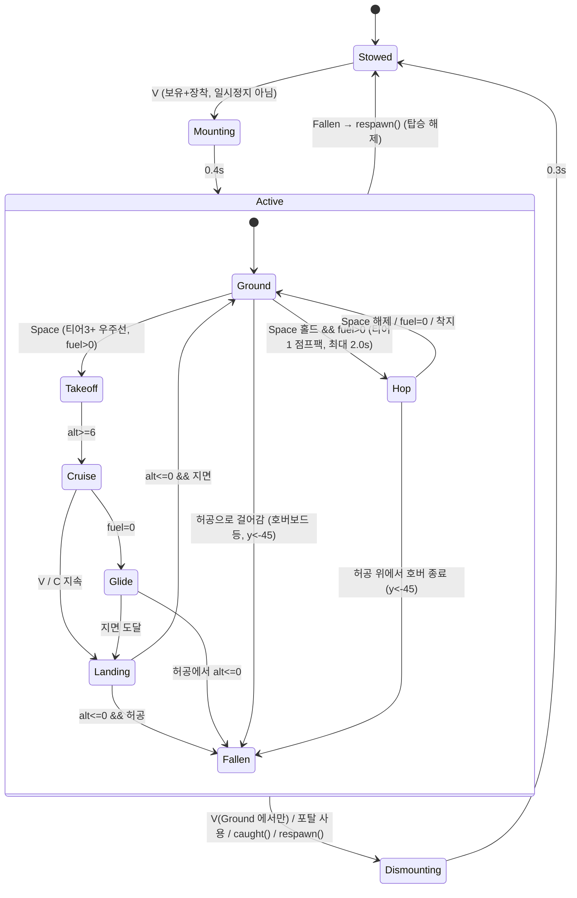
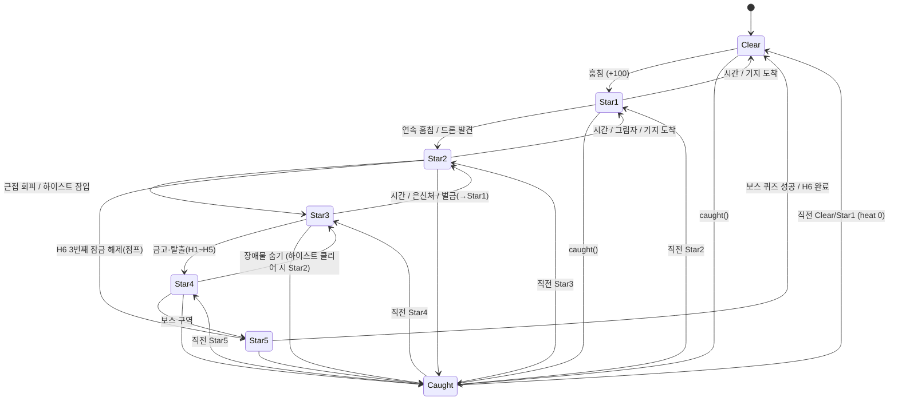
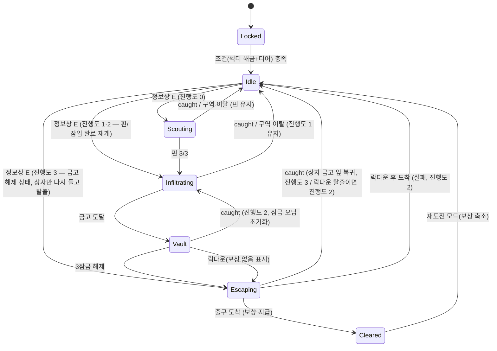

# 게임플레이 시스템 상세 기획 — M2(이동 수단) · M3(수배 + 하이스트)
> 상위 문서: [CONTENT_PLAN.md](CONTENT_PLAN.md) 3·4·5장(표의 골격), [STORY.md](STORY.md) v2.1 2·5·7.5·9장(무문자·시선 수호신·H6 추격·엔딩 전 S12는 H6 중심), [UX_CUTSCENE.md](UX_CUTSCENE.md) 10장(HUD 슬롯·A 버튼), [ROADMAP.md](ROADMAP.md) M2/M3, [CLIENT.md](CLIENT.md) 레지스트리·세이브 v5.
> 이 문서는 위 표를 **구현 가능한 규칙·수치·타입**으로 풀어 쓴다. 수치는 초안이며 최종값은 `data/pacing.ts` 한 곳에서 조정한다(ROADMAP "실측 먼저" 원칙).
> 표기: **S1~S12** = CONTENT_PLAN의 구역 번호. CLIENT.md의 현재 섹터 id(solar, exo, …)와 순서가 다르므로 **id 매핑은 CONTENT_PLAN 2장 매핑표로 확정(✅ 결정 1)**.

## 0. 설계 원칙 (공통)
1. **무문자**: HUD·월드 안내는 아이콘/모양/색/소리/진동 연출만. 글이 허용되는 곳은 퀴즈·상점 품목명·도감뿐(STORY 2장). 이 문서의 모든 "표시"는 아이콘이다.
2. **색만 쓰지 않기**: 단계 구분은 색 + 모양(개수·형태) 병행.
3. **데이터 주도**: 수치는 `data/vehicles.ts`, `data/wanted.ts`, `data/heists.ts` 테이블. 시스템 코드는 테이블을 읽기만 한다.
4. **세이브는 작게**: `id → 작은 숫자` 맵 유지(CLIENT.md, PUT 상한 256KB). 런타임 상태(연료, 드론 위치 등)는 저장하지 않는다.
5. **기존 루프 보존**: `caught()`, `respawn()`, `gravityNow()`, 수호자 AI의 의미를 바꾸지 않고 **배율·훅만 추가**한다.
---

## 1. 이동 수단 (M2)
### 1.1 단계별 스펙
| 티어 `S.vehicle` | 수단 | 해금 조건 | 속도 배율 `speedMul` | `hover()` | 핵심 효과 | 소모 자원 |
|---|---|---|---|---|---|---|
| 0 | 걷기 | 시작 | ×1.0 | false | 현행(스태미나 달리기 ×1.7) | 스태미나 |
| 1 | 점프팩 | S2 해금 + 렌치 구매(전용 퀘스트 없음 — QUESTS에 점프팩 퀘스트가 없다) | ×1.0 | 홀드 중만 true | 2단 점프, Space 길게 = 짧은 호버(최대 2.0초) | 연료 |
| 2 | 호버보드 | S4 진입 + 렌치 구매 + 점프팩 보유 | ×2.2 (지상) | false | 빙판 마찰 무시, 강풍 저항, 허공은 못 건넘(낙하 → `respawn()`) | 연료(부스트만) |
| 3 | 소형 우주선 | Q13(우주선 퀘스트, S5 N09 — QUESTS 2.2) 완료로 해금 + 렌치 구매(60,000, ECONOMY 4.3) | 순항 ×3.0 / 부스트 ×4.5 | **true** | 고도 6~40, **허공 횡단**, 섹터 간 직선 이동 | 연료 |
| 4 | 워프 드라이브 | H3(S10) 클리어 보상 "워프 코어"로 **해금** + 렌치 구매(250,000, ECONOMY 4.3 — S10 진입 조건이 아니라 H3 이후 구매). **관문은 돈이 아니라 하이스트 클리어**(사용자 확정, 가격은 클리어 후 구매 가능 기준) | 우주선과 동일 | 우주선과 동일 | 방문한 포탈로 즉시 이동(기존 포탈 UI 재사용) + 허공 중간 워프 불가 | 워프 충전 1칸(쿨다운 90초만, 충전 아이템 없음 ✅ 결정 10) |
| 5 | 중력 글라이더 | H4(S11) 클리어 보상으로 **해금** + 렌치 구매(400,000, ECONOMY 4.3). **관문은 돈이 아니라 하이스트 클리어**(사용자 확정, 가격은 클리어 후 구매 가능 기준) | 순항 ×3.4 | **true** | 강중력(×1.4 이상)·시간 지연 구역에서 우주선의 페널티 제거 | 연료 |

- **누적 규칙**: 상위 티어를 얻어도 하위 수단은 유지, 장착 선택 가능(`vehicles.eq`). `S.vehicle` = 보유 최고 티어(섹터 `requires.vehicle` 판정용).
- **섹터 `requires.vehicle` 정렬**: 티어 숫자를 `requires.vehicle`에 **직접 사용**한다(✅ 결정 2). 다만 CONTENT_PLAN 2장의 최종 해금 조건표에서 이동 수단이 걸리는 곳은 **S6 하나**(`vehicle: 3` = 우주선 보유 = Q13 완료 + 구매)뿐이다. 현행 `data/sectors.ts` 의 `requires.vehicle`(적색왜성 1 · 초신성 1 · 성운 1 · 펄서 2 · 중성자별 2 · 에드먼즈 3)은 M5 재배치 전의 **임시값**이라 M5 에서 CONTENT_PLAN 표로 교체한다. S7 이후는 어차피 티어 3을 보유하므로 vehicle 조건을 달지 않는다. **하이스트 보상 티어(4, 5)는 섹터 조건에 쓰지 않는다**(편의 수단이지 필수 관문이 아님).
- **우주선 제약(밸런스)**:
  - 강중력/시간 지연 섹터(`gravityMul ≥ 1.4` **또는** `timeMul ≥ 3`, S10·S11): 순항 ×2.2, 연료 소모 ×2, 최대 고도 20. 글라이더는 제한 없음. ⚠ 현행 `sectors.ts` 의 `gargantua`(S11)는 `gravityMul`이 기본값 1이고 `timeMul: 3`뿐이며(중력 1.4 이상은 `pulsar` 1.4 · `neutron` 1.8), S10 `supernova` 로 흡수될 때 어느 값을 물려받을지도 미정이다 → M5 에서 S10 `gravityMul 1.4`, S11 `gravityMul 1.4`(중력 파동 연출용)를 데이터로 부여하거나 위 OR 조건을 판정식으로 채택한다.
  - **잠긴 섹터 위는 못 난다**: `blockedAt` 벽은 비행에도 적용(고도 무관 투명 벽, 닿으면 튕김 + 잠금 아이콘 깜빡). 문 시험을 우회 불가.
  - 들고 있는 행성이 있으면 속도 페널티 `1 + ve/220`은 우주선에서 **절반**만 적용(배달 보상).
  - 비행 중 행성 훔치기/내려놓기 불가 — 착륙(`V`) 후에만 상호작용(수호자와 거리 두고 훔치는 "착륙 → 훔치기 → 이륙" 리듬 유도).
- **업그레이드**(상점 sink, 렌치): **수단별** 3트랙 × 3단계(ECONOMY 4.3: 가격 = 수단 가격 × 0.03/0.06/0.11, 트랙당 0.2P). `spd`(속도 +5%/Lv, **최대 Lv3**), `fuel`(연료 통 +20%/Lv, 최대 Lv3), `cargo`(비행 중 운반 가능 칸 수 +1, 최대 Lv3). 워프(티어 4)는 연료가 없으므로 `fuel` 트랙 = **워프 쿨다운 −10%/Lv**(QUESTS Q24 보상 "워프 쿨다운 −10%"와 같은 척도). 점프팩·호버보드의 `cargo`는 해당 없음이면 구매 목록에서 숨긴다. 가격은 `pacing.ts`(`VEHICLE_UPG`).
- 비행 중 운반 칸 수는 `cap()`(`1 + S.bag`)과 별개로 우주선 `cargo` Lv을 **더한다**: `capNow = cap() + (탑승 중 ? cargoLv : 0)`. 현행 `cap()` 은 `core/state.ts` 한 줄이라 시스템 훅(`capBonus?(): number`)으로 더하는 것이 안전하다(5.1).

### 1.2 조작
| 동작 | PC | 모바일 (UX 10.4·10.4.1: 전용 버튼 없이 A·점프·조이스틱) |
|---|---|---|
| 탑승/하차 | `V` | **A 버튼**이 🛹/🚀(탑승 가능) → `⏏`(탑승 중)로 변신. 전용 🛹/🚀 토글 버튼은 **취소** |
| 상승(점프팩 호버, 우주선) | `Space` 유지 | 점프 위치 버튼이 `⬆` 로 변신(홀드) |
| 하강(우주선) | `C` | 우주선 탑승 중에만 점프 버튼 근처에 `⬇` 추가(최대 3버튼: A·⬆·⬇) |
| 부스트 | `Shift` 유지(탑승 중엔 스태미나 달리기 대신 **연료**) | 조이스틱 **바깥 링**(달리기와 동일 제스처). ⚡ 버튼 없음 |
| 착륙(우주선) | 고도 6 이하에서 `V`, 또는 지면 위 하강 지속 | 고도 6 이하에서 A(`⏏`) 또는 `⬇` 유지. 🛬 버튼 없음 |
| 워프(티어4) | 포탈 패드 없이 `G` → 포탈 목록 오버레이 | 포탈 패드 앞에서는 A(🌀 → 목록), 그 외에는 `☰ → 🗺️ 지도/이동`의 워프 🌀(쿨다운 링). 전용 🌀 버튼은 **취소** |

- 탑승 중에는 **스태미나 달리기 비활성**(배율 이중 곱 방지). 점프팩은 지상 달리기 가능(속도 ×1.0이므로).
- 키는 `V`/`C`/`G`로 확정(✅ 결정 3, *키 배정*은 유지). `systems/input.ts` 점검 결과 현재 쓰는 키는 `E`·`F`·`B`(도감)·`Space`·`Shift`·`W A S D`·방향키·`Enter`·`Esc`·퀴즈 중 `Digit1~4` 뿐이라 `V/C/G` 는 비어 있다(충돌 없음). 키 처리는 `G.keys[e.code]` 맵에 `KeyV`/`KeyC`/`KeyG` 로 들어오며, 일회성 동작(탑승 토글·워프 목록)은 keydown 에서 `act()` 처럼 별도 분기가 필요하다(현재 `E`/`F`/`B` 만 keydown 분기). UX 10.4 에 따라 `V`·`G` 는 A/E 통합 후 **고급 단축키**로만 남는다.
- **모바일 비행 버튼은 UX 10.4.1 을 따른다**: 우하단은 `A(76px)` + `점프/⬆(60px)` 둘뿐이고 우주선에서만 `⬇` 가 추가된다. 이전 안의 "우하단 세로 배치 ⬆⬇⚡🛬🌀" 5버튼과 🛹/🚀 토글은 폐기(엄지 영역 과밀, UX 진단 D3).

### 1.3 연출 (글 없음)
- **탑승**: 0.4초 소환 이펙트(바닥에 원형 파동 → 기체가 캐릭터 아래에서 펼쳐짐). 하차는 역재생.
- **점프팩**: 등 뒤 불꽃 파티클, 연료 게이지는 **캐릭터 머리 위 호(arc) 아이콘**(스태미나 바와 모양이 다름).
- **호버보드**: 지면에 청색 빛줄기 + 발광 궤적(속도에 비례해 길어짐), 빙판에서 불꽃이 아닌 물결 무늬로 "미끄러지지 않음" 표시.
- **우주선**: 이륙 시 카메라 거리 +30%·FOV 상승, 속도선(streak) 파티클. 고도계는 숫자 없이 **지면 그림자 크기**와 우측 세로 막대(고도 위치 점).
- **연료 부족**: 게이지가 비면 붉은 깜빡임 + 경고음 3회 → 강제 하강(우주선은 활강 속도 ×0.6로 가장 가까운 지면으로 자동 조향). **허공 위에서 연료가 다 떨어지면** 활강으로 지면에 닿지 못하면 `respawn()`(돈 손실 없음, 행성 제자리).
- **워프**: 화면 가운데로 빨려드는 줄무늬 0.6초 → 도착 지점에서 역재생. 쿨다운은 🌀 아이콘이 시계 방향으로 채워짐.
- **정비사 렌치(NPC, QUESTS N03)**: 머리 위 🔧 아이콘, 구매는 기존 상점 UI(품목명·가격만 글). 부품 수집은 우주선 퀘스트 **Q13**(S5 우주선 수리공 N09, 🔧×3)이며 아이콘 요구 3개(⚙⚙⚙)가 칸에 채워지는 방식. 점프팩·호버보드는 퀘스트 없이 렌치에서 구매.

### 1.4 상태 `S.vehicle` / `S.vehicles` / 런타임
- 저장: `S.vehicle`(보유 최고 티어, 숫자), `S.vehicles`(`Record<string, number>`, 희소 맵 — 기본값 `{}`: `own1..own5`=보유 1, `eq`=장착 티어, `up{티어}{s|f|c}`=수단별 업그레이드 Lv(속도/연료/적재, 예 `up3f`; 1.1 업그레이드는 ECONOMY 4.3 에 따라 **수단별**이라 전역 `spd/fuel/cargo` 3개로는 표현 불가), `warp`=**0/1 충전 여부**(시각을 저장하지 않으므로 재접속하면 항상 충전 상태 — 쿨다운 90초는 비저장 `warpCd`)). `S.vehicle` 은 `own*` 에서 파생되는 값이므로 `onSave` 에서 `max(own 티어)` 로 재계산해 불일치를 막는다.
- 런타임(비저장): `mounted`, `fuel`(0~100), `alt`(우주선 고도), `warpCd`(초), `boosting`.
- 로드 시: 항상 **하차 상태**로 시작, 연료 가득(저장 복원이 어색한 위치 문제 방지).
---

## 2. 수배(경계도) 시스템 (M3-a)
### 2.1 모델
- `S.wanted` = **열기(heat) 0~500의 정수**. 눈 단계 `stars = ceil(heat / 100)` (0이면 0단계). 숫자 구간으로 저장해 시간 경과 감쇠를 연속 처리하고, UI는 **눈 단계**만 보인다.
- **용어**: 코드 식별자·수식의 `stars`/`Stars`/`floorStars` 는 유지하지만, 플레이어에게 보이는 개념은 별(⭐)이 아니라 **눈 단계**다(별조각 ⭐과 혼동 방지, 무문자 규칙). 이 문서의 `★n` 표기는 "눈 n단계"의 약칭이며 HUD 에 ★ 모양은 나오지 않는다(2.3).
- 상승은 이벤트 가산, 하락은 초당 감쇠 + 특수 행동. 하이스트·보스는 **하한(floor)** 을 걸어 내려가지 않게 한다.
- 잡힘(`caught()`) 손실률: 기존 5%/15%(현행 `actions.ts`: 빈손 5%, 행성 소지 15%) × `(1 + 0.25 × stars)`, 상한 40%. 현 수치로는 최대 15% × 2.25 = **33.75%** 라 상한 40%는 도달하지 않는 안전장치일 뿐이다. 잡히면 열기는 **한 단계 내려간다**(`heat = max(floor, (stars-1)*100)`, ★1 이하에서 잡히면 0). 하이스트 하한(`floor`)은 ★2 = 101(H6 폭발 전 잠입만) · ★3 = 201 · ★4 = 301 · ★5 = 401(= 해당 눈 단계의 최소 열기)이고, 하이스트가 일시 중지(구역 이탈)되거나 끝나면 0 으로 푼다.

### 2.2 단계별 규칙 표
| 눈 단계 | 열기 구간 | 상승 조건 | 하락 조건 | 수호신/적 반응 | 시각 표현 |
|---|---|---|---|---|---|
| 0 | 0 | — | — | 평소(구역 수호자 추격형 + 섹터 사이 숨바꼭질형) | 눈 아이콘 감김(회색, HUD 숨김) |
| ★1 | 1~100 | 행성을 훔침 +100 | 시간 -2/s(약 50초) · 기지 도착 시 즉시 0 | 수호자 속도 +10% | 반쯤 뜬 눈 1칸 · 노란색 · 화면 변화 없음 |
| ★2 | 101~200 | 60초 내 연속 훔침 +100 · 드론에게 발견 +30/s | 시간 -1/s · 그림자 지대 -4/s · 기지 도착 시 100으로 | 수호자 +15%, **감시 드론** 구역당 1기 공중 순찰(시야 원뿔 18m, 발견 시 수호자를 해당 위치로 호출) | 눈 2칸 · 주황 · 드론 머리 위 ◇ 아이콘 + 원뿔 바닥 표시 |
| ★3 | 201~300 | 수호자 근접 회피(5m 이내, 쿨 3초) +50 · 하이스트 잠입 중 하한 | 시간 -0.5/s · 그림자 -3/s · 은신처 안 -8/s · **벌금**(해결사 NPC, 보유금 3%) → 100으로 | 수호자 +20%, **추적자** 1기(속도 = 걷기 기본 ×1.05, 직선 추적, 3초 접촉 시 `caught()`) | 눈 3칸 · 붉은색 · 추적자 △ 아이콘 · 화면 가장자리 약한 맥동 |
| ★4 | 301~400 | 하이스트 금고 단계·탈출 중 하한 · 드론에 연속 노출 | **시간 감쇠 없음** · 장애물 뒤 시야 차단 5초 지속 시 -6/s · 하이스트 클리어 시 200으로 | 수호자 +25%, **순찰선**(비행체, 우주선 순항 ×0.9) 추격: 비행 중에도 따라붙음 | 눈 4칸 · 진홍 · 순찰선 ▣ 아이콘 · 비네트 맥동 + 심장 박동음 |
| ★5 | 401~500 | **H6 마지막(3번째) 잠금 해제 시 점프**(★4를 거치지 않음, 3.7) · 보스 구역 진입 | **감쇠 없음** · 보스 격파 퀴즈 성공 / H6 완료 시 0 | 수호자 +30%, **사령관**(구역 보스: 느리지만 시야각 넓음, 순간이동 점프) | 눈 5칸 + 불꽃 · 화면 테두리 붉은 번쩍 · 음악 템포 상승 |

- **은신 지형**(구역 고유): 그림자 지대(S7 쌍성 그림자), 안개(S9 성운), 장애물 뒤. `Sector.hideout?: Rect[]`를 데이터로 둔다. 은신처(건물 아이콘 🕳)는 수호자 시야 판정에서 제외 + 감쇠 가속.
- **시선 수호신과의 관계**(STORY 5.1): 숨바꼭질형이 플레이어를 **닿으면** `caught()`와 동일 처리(열기 +50 가산 후 처리). 바라보고 있으면(시야 내) 열기는 오르지 않는다.
- **기지 안(`inBase`)**: 수호자/드론은 들어오지 못하지만 열기 감쇠는 ★2 이하만 즉시 적용. ★3 이상은 기지에 숨어도 **그 값을 유지하며 천천히(-1/s) 식음**(안전지대 남용 방지)(✅ 결정 4).
- **라이벌 침입**(`rival`)과 독립. 라이벌을 막으면 열기 -30(작은 보상, 선택).

### 2.3 HUD 레이아웃
- **위치**: 눈 단계 위젯은 UX 10.3.1 의 **TC(상단 중앙) 주의 슬롯**에 놓는다. 이전 안(좌상단 `#lines`)은 폐기 — TL 은 💰·🍎 전용이고 TR 에는 경계 위젯을 두지 않는다(UX 10.3.1). TC 는 한 번에 1개이며 우선순위 큐는 `잡힘/추격(⚠) > 경계 상승(눈꺼풀+🚨) > 수호신 시선(👁️) > 의뢰 변화(❗) > 연료 경고`다. 눈 단계가 1 이상인 동안은 눈꺼풀 위젯이 TC 의 기본 후보이고, 단계가 오르는 순간에는 "경계 상승" 우선순위로 즉시 표시된다. 추격(⚠) 중에는 ⚠ 위젯 옆에 눈 단계 점(●1~5)으로 축소 병기한다.
- **표현**: 5칸 눈꺼풀 막대. 켜진 칸 수 = 눈 단계, 아이콘 내부 홍채 크기 = 구간 내 열기 비율(다음 단계까지 얼마나 남았는지). ⚠ 현행 `hud(): string | null` 은 `renderHudLines()` 가 `#lines.textContent` 에 문자열을 합쳐 넣으므로(`game/hud.ts`) **이모지·기호 문자열만** 표현할 수 있다(👁️👁️○○○ 수준). 홍채 크기·눈 모양 애니메이션·SVG 게이지는 불가 → UX_CUTSCENE 10.3.2 의 `HudWidget{slot, priority, icons[], fill?}`(문자열 줄 폐지)로 확장해야 한다(5.1). `wanted` 는 `slot: 'TC'`, `priority` 는 위 큐 순위, `icons[]` = 눈 모양, `fill` = 홍채 비율을 반환한다. 문자열 방식으로 갈 경우 단계 구분은 이모지 개수(👁️ 칸 수)로만 한다.
- 하락 중이면 눈이 **서서히 감기는 애니메이션**, 상승 시 번쩍 + 소리. 기지 위에서는 눈에 🏠 배지.
- 접근성: 눈 단계마다 **눈 모양이 달라진다**(반개 → 전개 → 충혈선 → 불꽃 눈동자) — 색을 못 봐도 모양으로 구분.
---

## 3. 하이스트 6개 (M3-b)
### 3.1 공통 구조
- **4단계**: 정찰 → 잠입 → 연속 퀴즈 금고 → 탈출 추격. 각 단계 약 3분, 합계 **약 12분**(**이동 제외 순수 플레이**, ✅ 결정 12. 구역까지의 이동은 각 구역 수단으로 별도). **예외: H6 은 STORY 5.4 의 시각 배분을 따른다** — 정찰 5분 · 잠입/퀴즈 10분 · 추격 8분 = **23분**(3.7).
- **시작**: 구역 안 **정보상 NPC**(머리 위 🕶)에게 말을 걸면 시작. 정보상은 아이콘 지도(핀 3개)만 보여준다.
- **임시 보호 장비(H1·H2)**: H1(방사선)·H2(고온)는 그 구역 환경이 방호복/방열복 1등급을 요구하지만 1등급은 클리어 보상(ECONOMY 4.4)이므로, 정보상이 정찰 단계 시작 때 **하이스트 전용 임시 보호 게이지**를 지급하고 클리어 시 영구 1등급으로 전환한다. 이 장치가 없으면 "보상으로 받는 장비가 있어야 시작할 수 있는" 순환이 생긴다.
- **정찰**: 월드 위 핀 3개(🔍)를 모두 방문(근접 3m + E). 순서 무관. 핀마다 간단한 관찰 과제(경비 패턴을 눈으로 보기)가 있어 **잠입 시 경로 힌트**가 된다(다음 단계의 안전 경로 표시 선이 부분 노출).
- **잠입**: 하이스트 전용 구역(`HeistZone`, 구역 안의 사각형)에 진입. 열기 하한 ★3(H1~H5). **H6 만 예외**: 폭발 전 잠입·퀴즈 동안 하한은 **★2**로 완화하고(STORY 5.4 "정찰·잠입 중에는 평소 수호신 규칙"), 3번째 잠금이 풀리는 순간 ★5 로 점프한다(3.7). 폭발 전부터 ★4(시간 감쇠 없음·순찰선)면 "참다 참다 폭발"의 낙차가 사라진다.
- **금고**: 잠금 3개. 잠금마다 퀴즈 1문(연속 3문). 오답 1회 = 경보(열기 +100, 경비 증원 1) 후 같은 잠금에서 다른 문제 재시도, 오답 **누적 3회 = 락다운**(✅ 결정 9: 3회 확정, `pacing.ts`의 `maxWrong`로 조정 가능)(금고 닫힘, 탈출 단계 강제 시작 + 전리품 없음, "실패" 처리 → 3.8).
- **탈출**: 금고에서 가져온 보상 오브젝트(빛나는 상자)를 들고(운반 규칙은 행성과 같음 → 속도 페널티) **출구 마커(🚪)** 까지 가야 한다. 열기 ★4, 추격 연출.
- **퀴즈 연동**: `QuizCtx`에 `heist: id` 컨텍스트를 추가해 기존 퀴즈 UI 재사용. 문제는 `GQU` 중 해당 `units` 태그에서 뽑되 **이미지 문제 우선**(STORY 10장), 해설 1문장. 정답 시 자물쇠가 풀리는 애니메이션(열쇠 구멍 모양이 문제 주제와 연관된 도형). ⚠ 현행 `openQuiz` 로는 부족한 점 3가지: ① `QuizCtx` 는 **끝날 때 한 번** `onDone(ok)`만 부르고(`need` 개 이상 맞히면 ok) 문항별 콜백이 없어 "오답 1회 = 경보·다른 문제 재시도"를 표현할 수 없다 → `onAnswer?(ok: boolean, i: number)` 와 `retry?: () => string[]`(같은 잠금에서 새 문제) 필요. ② `closeQuiz(false)`(✕/Esc)는 "한 문제라도 답했으면 결과를 반영"하므로 금고 퀴즈에서는 닫기를 **오답 1회로 간주**하거나 닫기 불가로 해야 경보를 회피하지 못한다. ③ 문제 행이 `string[]`(`[문제, 정답, 오답×3, 해설]`)뿐이라 이미지 문제(`img`, QUIZ_BANK 1장)를 실을 자리가 없다 → `QuizCtx.qs` 를 `QuizRow = string[] & {img?: …}` 같은 확장형으로 바꾸는 것이 `heist` 필드보다 먼저다.
- **보상**: 1회성 보상(최초 클리어) + 재도전 모드 보상(코인 소량 + 하이스트별 수집품 1개(`S.collectibles`, M6와 함께 활성), 도감 진행 없음)(✅ 결정 11). "코인" = `S.cr` 에 가산하는 금화(금액은 ECONOMY의 구역 평균 행성 가격 %, QUESTS 2.1과 같은 척도)다. 기존 `S.coins`(`Record<string, number>`)는 키 규약이 없는 빈 맵이므로 통화로 쓰지 않는다(필요하면 `S.coins['H1r']`처럼 재도전 수령 기록 용도).
- **세이브 체크포인트**: `S.heists[id]`(진행도) — 3.8 참고.

### 3.2 H1 — 목성 방사선 터널 (S3 · `jovian`)
| 항목 | 내용 |
|---|---|
| 목표 | 방사선 터널 끝의 금고에서 "방호 코어"를 가져온다 |
| 구역 | 목성계 S3(`jovian`), 위성 사이의 터널형 구간(길쭉한 `HeistZone`) |
| 단계 | ① 정찰 핀 3개(터널 입구·중간 점검구·금고 문)에서 방사선 파동 주기 관찰 ② 잠입: 터널을 파동 사이 틈으로 통과(방사선 구간 = 회전 부채꼴, 닿으면 화면 흰 번쩍 + 속도 ×0.5, 3초 누적 시 `caught`) ③ 금고 3문 ④ 탈출: 같은 터널을 역주행, 파동 속도 +30% + 수호자 추격 |
| 위험요소 | 회전 방사선 부채꼴, 방호복 게이지(시간제 피해), 점프팩으로만 오르는 단차 |
| 퀴즈 | 중력·궤도(`sci1-3-3`): 위성 궤도 그림 고르기, "궤도 = 낙하" 그림(ISS 무중력 느낌) — **케플러 법칙은 교육과정 밖이라 출제 금지**(CURRICULUM 8.4, QUIZ_BANK 4.3) |
| 필요 이동 수단 | 점프팩(티어 1) |
| 보상 | 방호복 **1등급 지급**(방사선 면역 시간 +50%; ECONOMY 4.4 — 이후 2·3등급만 구매), 최초 클리어 코인 |

### 3.3 H2 — 뜨거운 비 속의 금고 (S8 · `hotjup`)
| 항목 | 내용 |
|---|---|
| 목표 | 뜨거운 비가 쏟아지는 평원 한가운데 금고를 연다 |
| 구역 | 뜨거운 목성들 S8(`hotjup`), 평원 + 중앙 금고 돔 |
| 단계 | ① 정찰: 비 구역(💧 파란 방울)과 마른 구역(☂ 지붕) 위치 파악 ② 잠입: 지붕 패드 사이를 이동 — 비를 맞는 시간이 방열복 게이지를 깎음, 게이지 0이면 지붕 패드로 강제 귀환 ③ 금고: 상태 변화 퀴즈(고체·액체·기체 순서 맞추기) ④ 탈출: 비가 증발 구름으로 바뀌어 시야 저하, 순찰 드론 다수 |
| 위험요소 | 뜨거운 비(시간제 피해), 증발 구름(시야), 미끄러운 젖은 바닥(호버보드 유리) |
| 퀴즈 | 산화·상태 변화: 얼음→물→수증기 순서 카드, 열 이동 그림 |
| 필요 이동 수단 | 호버보드(티어 2) 권장(필수 아님: 걸어서도 가능하나 제한 시간 빡빡) |
| 보상 | 방열복 **1등급 지급**(ECONOMY 4.4 — 이후 2·3등급만 구매), 유니크 행성 1종("증발하지 않는 유리 행성" 가칭, ✅ 결정 5: M5 행성 80종 확정 시 `hotjup` 행성 중 하나를 배정, 그 전까지 가칭 유지 — PLANET_CATALOG S8 후보: HD 189733b "유리 비") |

### 3.4 H3 — 펄서의 심장 (S10 · `supernova`)
| 항목 | 내용 |
|---|---|
| 목표 | 펄서의 자기장 한가운데 "심장"(워프 코어)을 가져온다 |
| 구역 | 초신성 잔해·죽은 별 S10(`supernova`), 중심에 펄서 + 등대처럼 회전하는 빔 |
| 단계 | ① 정찰: 빔 회전 주기를 3개 지점에서 관찰 ② 잠입: 빔의 그림자 안으로만 이동(빔 = 거대한 회전 선, 맞으면 `caught`), 자기장 교란으로 **조작이 주기적으로 좌우 반전** ③ 금고: 별의 일생 순서 퀴즈 ④ 탈출: 빔 속도 증가 + 우주선 순찰 |
| 위험요소 | 회전 빔, 조작 교란(입력 반전 0.7초 경고음 후 3초), 강중력 ×1.4 |
| 퀴즈 | 별의 일생: 성운→주계열→적색거성→초신성→중성자별 순서 맞추기 (이미지 카드) |
| 필요 이동 수단 | 우주선(티어 3) 필수 — 빔 아래로 낮게 날아 통과하는 구간 |
| 보상 | **워프 코어 → 이동 수단 티어 4 해금**, 최초 클리어 코인 |

### 3.5 H4 — 강착원반 통과 (S11 · `gargantua`)
| 항목 | 내용 |
|---|---|
| 목표 | 블랙홀 강착원반의 회전 고리를 건너 중심부 금고를 연다 |
| 구역 | 가르강튀아 S11(`gargantua`), 블랙홀 + 고리형 플랫폼 |
| 단계 | ① 정찰: 고리 회전 방향·속도를 핀에서 관찰 ② 잠입: 회전하는 고리 플랫폼을 건너뜀(타이밍 점프), 가장자리에서 **중력 파동**(주기적 끌림), 구역 내 `timeMul ×3`이라 기지 수익은 빠르지만 하이스트 타이머도 빠르게 흐르는 연출 ③ 금고: 중력 개념 퀴즈 ④ 탈출: 고리가 빨라지고 파동 강해짐 |
| 위험요소 | 회전 플랫폼, 중력 파동(밀림 벡터), 낙하 = `respawn()` |
| 퀴즈 | 중력 개념(`sci1-3-3`, QUIZ_BANK `alsoZones:[11]`): 행성별 중력 가속도 g 비교 그림, "중력을 이겨야 벗어난다"는 **개념** 그림 고르기. 거리 제곱 반비례 그래프·탈출 속도 공식·시간 지연 계산은 교육과정 밖이라 금지(CURRICULUM 6.1·8.4, QUIZ_BANK 4.3) |
| 필요 이동 수단 | 우주선(티어 3) — 우주선은 강중력 페널티를 받으므로 **불편함 자체가 보상 동기** |
| 보상 | **중력 글라이더(티어 5)** |

### 3.6 H5 — 수호신의 사원 (S12 · `alpha`) — **엔딩 후로 이월**
> STORY 6.1·9장: 엔딩 전 S12 는 H6 중심(진입 9:45, 삼성 발견 9:50)이라 H5 는 **엔딩 후(`S.story.ended === 1`) 해금**한다. `HeistDef.requires.afterEnding: true`, 엔딩 전에는 정보상이 H5 를 열지 않는다(🔒). 수호신의 시점에서 사과와 삼성을 바라보는 곳(칼 단서 ②와 연결). H5 는 **H6 의 선행 조건이 아니다**(`H6.requires.prev` 에서 제외, 3.7). 업적 A43(H1~H5 전부)은 사실상 엔딩 후 달성.

| 항목 | 내용 |
|---|---|
| 목표 | 사원 깊은 곳 제단의 장식·장비를 가져온다 |
| 구역 | 알파 센타우리·판도라 S12(`alpha`), 사원 내부 방 4개 |
| 단계 | ① 정찰: 석상(수호신 조각) 3개의 위치와 움직임 규칙 확인 ② 잠입: **시선 수호신 규칙을 퍼즐로 응용** — 바라보는 동안 석상이 멈추고, 등지면 다가온다. 방마다 석상 2~3개를 시야로 가두며 통과 ③ 금고: 에너지·생태 퀴즈(먹이 사슬 그림, 에너지 흐름) ④ 탈출: 석상이 전부 깨어나 추격, 발광 식물(밤 발광)을 따라 길 찾기 |
| 위험요소 | 시선형 석상(`watcher` 규칙 재사용), 독가스 구간, 0.8g, 밤에 적대 생물 |
| 퀴즈 | 에너지·생태: 먹이 사슬 순서, 광합성/에너지 전환 그림 |
| 필요 이동 수단 | 없음(실내). 글라이더 보유 시 입구 지름길만 |
| 보상 | 사원 장식(기지 꾸미기), 유니크 장비 1종 |

### 3.7 H6 — 삼성 행성, 마지막 한탕 (마지막 섹터 · `alpha`)
| 항목 | 내용 |
|---|---|
| 목표 | 3연 행성 둥지(`kind: 'triple'`)에서 3개를 한 번에 훔쳐 기지에 도착 |
| 구역 | 마지막 섹터 S12 `alpha`(STORY 9장), 삼성 둥지 구역. 선행: `requires = {vehicle: 3, cap: 3, prev: 'H4'}` — **H5 는 제외**(엔딩 후 이월, 3.6). 엔딩 전 S12 는 H6 동선 맛보기뿐 |
| 시각 배분 (H6 예외) | 정찰 **5분**(9:45~9:50) → 잠입·퀴즈 **10분**(9:50~10:00) → 추격 **8분**(10:00~10:08), 합 23분. 일반 하이스트의 4×3분(12분)과 다르다. `budgetSec` = 1380 |
| 단계 | ① 정찰: 전용 가방 확인(요구: 운반 `cap ≥ 3` — 선행 가방 업그레이드) + 경로 핀 3개 — **마지막(3번째) 핀 방문 시 `beat` 4→5(C05 "마지막 한탕 발견")** ② 잠입: 둥지까지 접근. **열기 하한 ★2(폭발 전 완화, 일반 하이스트의 ★3 보다 낮음)** — 평소 수호신 규칙(구역=추격형, 사이=숨바꼭질형)을 그대로 쓰고, 하이스트 최종 구역은 이전 하이스트 장치(빔·회전·시선) **혼합** ③ 금고 대신 **연속 퀴즈 3문**(에너지 종합, 잠금 3개) — 정답마다 둥지 잠금 1개씩 풀리고, **3번째(마지막) 잠금이 풀리는 순간 3개 행성이 한꺼번에 풀리며 `beat` 5→6(STORY 비트 6 추격전 컷신 C06) 발동, 열기 하한이 ★2→★5 로 점프**(`heat = max(heat, 401)`, ★3·★4 단계 연출 생략) ④ 탈출: **전용 추격전**(수호자 속도 배수, 사령관 ★5), 성공 조건 = **S12 포탈 패드를 통과해 허브 기지에 도착**(STORY 5.4 — 이 포탈만 하이스트 포탈 차단의 예외로 열린다) |
| 위험요소 | 모든 위험 혼합, 추격 중 장애물 연출(STORY 5.4), 사령관 순간이동 |
| 퀴즈 | 에너지 종합(핵융합·발전·보존) 이미지 문제 위주 |
| 필요 이동 수단 | 우주선 이상 권장, 추격 중엔 **하차 불가**(기체 고정) |
| 보상 | 스토리 진행(**beat 규칙**): 마지막 정찰 핀 → `beat` 5 / **3번째 잠금 해제 시 `beat` = 6**(추격 개시 컷신 C06) / **허브 도착(S12 포탈 패드 통과) 시 `beat` = 7**(C07 "안전 확보"). `beat` 는 단조 증가이며 추격 중 `caught()` 로 기지에 돌아가도 6 을 유지하고 컷신은 `seen` 으로 재생하지 않는다. 행성 3개는 컷신 후 STORY 규칙대로 처리(기지에 놓이고 암시장 판매는 비트 8) |

### 3.8 실패 / 재시도 규칙
| 상황 | 처리 | 진행 보존 |
|---|---|---|
| 정찰·잠입 중 `caught()` | 기지로 복귀, 기존 돈 손실 규칙 적용 | 정찰 완료 상태 유지(핀 재방문 불필요). 정찰 중 잡히면 방문한 핀(`HeistRuntime.pins` 비트마스크)은 유지하고 진행도는 0 그대로 |
| 금고 퀴즈 중 `caught()`(경보로 증원이 온 경우) | 기지로 복귀 | 진행도를 잠입 완료(2)로 되돌림, 열린 잠금·누적 오답은 초기화(4.3의 `Vault → Infiltrating`) |
| 락다운 후 탈출 중 `caught()` | 기지로 복귀(전리품이 없으므로 상자 복귀 없음) | 진행도 2, 같은 락다운 재개 없음 — 정보상에서 다시 시작 |
| 금고 오답 누적 3회(락다운) | 금고 닫힘 → 탈출 단계 강제 시작(보상 없음). 탈출 성공해도 "실패" | 진행도를 잠입 완료(2)로 되돌림, 퀴즈 문제 재추첨 |
| 탈출 중 `caught()` | 전리품 상자 둥지로 복귀(금고 앞에 다시 생성) | 금고 해제 상태(3) 유지: 상자만 다시 들고 탈출 |
| 제한 시간(단계 타이머) 초과 | 단계 시작점으로 순간 복귀(감점 없음) | 단계 진행 유지 |
| 완전 이탈(구역 밖으로 나감) | 하이스트 일시 중지(재진입 시 단계 시작점에서 재개) | 진행도 유지 |
| 클리어 후 | 정보상에서 **재도전 모드**(보상 = 코인 + 수집품 1개, 도감·유니크 없음, 열기 규칙 동일) | `H#` 클리어 횟수 +1 |

- 하이스트 중 `respawn()`(허공 낙하)은 하이스트 단계 시작점으로 복귀(허브 스폰 아님).
- 하이스트 활성 중에는 **포탈·워프 사용 불가**(아이콘 🚫), 이탈 사유 최소화. **예외(추격 중 `portalBlocked` 예외): H6 탈출 단계(`beat === 6`)에서는 S12 포탈 패드 → 허브 이동만 허용**(STORY 5.4·비트 7: 성공 조건, 이 패드를 통과해 허브에 도착해야 `beat` 7). 그 외 패드·워프(`G`/🗺️)는 계속 🚫. 현행 `portalIt.find`/`openPortal`은 패드 목록 전체를 보여 주므로 `portalBlocked?()` 가 `{allow: string[]}`(허용 패드 id, H6 탈출 중 `['S12']` 하나)를 돌려줄 수 있어야 한다. 방향 화살표는 추격 중 🏠 우선(UX 10.3.2)이 이 패드를 가리킨다. 추격 중 `caught()` 는 기지 복귀 후 정보상에서 탈출 단계 재개(진행도 3 유지, 이때도 ★5 점프 상태에서 시작).
---

## 4. 상태 머신
### 4.1 이동 수단


- 부스트(`Shift && fuel>0`)는 상태가 아니라 `boosting` 플래그다 — Ground·Cruise 어디서든 켜지고(우주선 순항 ×3.0 → 부스트 ×4.5) `Shift` 해제 / `fuel=0` 으로 꺼진다.
- `speedMul()` = Stowed 1.0 / Active는 티어표 × `spd` 업그레이드 / Glide ×0.6. `hover()` = Hop·Takeoff·Cruise·Landing·Glide 중 true(**Ground·Fallen 은 false** — Fallen 은 중력으로 떨어져야 `movePlayer` 의 `y < -45 → respawn()` 이 발동한다.).
- **연료 회복**: 연료 0 에서 `Glide → Landing → Ground` 로 내려온 뒤 회복 규칙이 없으면 "로드 시 연료 가득"(1.4) 외에 채울 길이 없어 우주선·점프팩이 새로고침 전까지 못 뜬다(소프트락). 따라서 `Stowed`·`Ground`(정지) 에서 초당 `fuelRegen`(데이터 `VehicleDef`, 초안 8/s ≈ 12초 만충), `inBase` 위에서는 ×3 로 회복하고, `Takeoff`·`Hop` 은 `fuel > 0`(회복 중 최소 5)일 때만 허용한다.
- `Dismounting` 진입 사유 중 `caught()`·`respawn()`·`warpTo()` 는 시스템이 호출 시점을 알 수 없다 → 5.1 의 `onReset(reason)` 훅이 필요하다(좌표가 `SPAWN`/패드로 순간 이동하므로 위치 변화 감지로는 구분이 안 된다).

### 4.2 수배


- `Caught` 는 **복귀 상태가 직전 별 −1** 이다(`heat = max(floor, (stars-1)*100)`). 0성에서도 `caught()` 는 5% 손실이 발생하므로 `Clear → Caught` 전이가 있어야 하고, `Star5` 에서도 잡힐 수 있다. 하이스트 하한(`floor`)이 걸려 있으면 위 표의 결과 상태보다 `floor` 가 우선한다(예: H1~H5 잠입 중 ★3 하한이면 `Caught → Star3` 유지).
- `Star5 → Clear` 는 H6 완료/보스 격파로만 가능하고 `Star5` 에는 시간 감쇠가 없다. H6 는 폭발 전 하한이 ★2 라 `Star2 → Star5` 점프 전이가 있다(3.7). H6 가 추격 중 실패(= `Caught`)해 `Star4` 로 내려가도 하한이 풀려 있어야 **교착이 없다**(H6 재시도 때 정보상에서 탈출 단계를 재개하며 다시 ★5 로 점프).

### 4.3 하이스트


- 탈출 중 `caught` 는 3.8("금고 해제 상태(3) 유지: 상자만 다시 들고 탈출")에 따라 `Vault`(퀴즈 재풀이)가 아니라 기지(`Idle`)로 복귀했다가 정보상 E 로 `Escaping` 에 바로 재진입한다. `Idle → Infiltrating/Escaping` 재개 전이와 `Scouting`·`Vault` 중 `caught` 전이가 있어야 진행도 1~3 에서 정보상이 정찰부터 다시 시작하는 모순(3.8 "핀 재방문 불필요", 수용 기준 C8)이 생기지 않는다.
- 구역 이탈 = 일시 중지는 별도 상태 대신 `Idle`(진행도 유지)로 본다. 재개 위치는 항상 단계 시작점이다.

---

## 5. 데이터 구조 초안 (TypeScript)
CLIENT.md 규칙: `core/types.ts`에 필드 선언 + `save-schema.ts` `defaults()`의 빈 기본값(이미 `wanted: 0, vehicle: 0, vehicles: {}, heists: {}`). **v5 안에서 의미 해석만 정의하므로 `SAVE_VER` 변경 없음**(v6은 STORY의 `story` 추가 시점).

```ts
// ── 이동 수단 (data/vehicles.ts) ─────────────────────────
export type VehicleTier = 0 | 1 | 2 | 3 | 4 | 5;
export interface VehicleDef {
  tier: VehicleTier;
  id: 'walk' | 'jetpack' | 'hoverboard' | 'ship' | 'warp' | 'glider';
  icon: string;                      // HUD/탑승 아이콘 (글 없음)
  speed: number;                     // 지상/순항 배율
  boost: number;                     // 부스트 배율 (1 = 없음)
  hover: 'none' | 'hold' | 'free';   // none=지상 / hold=Space 홀드 호버 / free=자유 비행
  altRange?: [number, number];       // free 일 때 고도 범위
  ignoreIce: boolean;
  fuelMax: number;                   // 0 = 연료 없음
  fuelDrain: {idle: number; boost: number};   // 초당
  fuelRegen: number;                 // 초당 회복(Stowed·Ground 정지 시, inBase 는 ×3) — 4.1 소프트락 방지
  heavyGravPenalty: {speedMul: number; drainMul: number; altCap?: number};  // gravityMul>=1.4
  cargoSlots: number;
  unlock: {sector: string; quest?: string; heist?: string; price: number};
}
// S.vehicles 키 규약 (값은 모두 작은 정수). 기본값 {} 인 희소 맵이라 Partial — 없는 키는 0
// up{티어}{s|f|c} = 수단별 업그레이드 Lv(속도/연료·워프는 쿨다운/적재), 예 'up3f'
export type VehiclesSave = Partial<Record<
  'own1' | 'own2' | 'own3' | 'own4' | 'own5' | 'eq' | 'warp' | `up${1 | 2 | 3 | 4 | 5}${'s' | 'f' | 'c'}`, number>>;
export interface VehicleRuntime {
  mounted: boolean; fuel: number; alt: number; boosting: boolean; warpCd: number;
  phase: 'stowed'|'mounting'|'ground'|'hop'|'takeoff'|'cruise'|'landing'|'glide'|'fallen'|'dismounting'; // 4.1 상태와 1:1 (boost 는 boosting 플래그)
}

// ── 수배 (data/wanted.ts) ───────────────────────────────
export type Stars = 0 | 1 | 2 | 3 | 4 | 5;
export interface WantedTier {
  stars: Stars;
  maxHeat: number;                         // 100*stars
  decay: {time: number; shadow: number; hideout: number; hidden: number; home: number};  // /s, 0 = 없음. home = 기지 안 감쇠(★2 이하는 즉시 규칙이라 별도 처리, ★3+ 는 −1/s)
  guardMul: number;                        // 수호자 속도 배율
  spawn: ('drone'|'chaser'|'patrol'|'commander')[];
  lossRate: number;                        // caught() 손실 배율
  icon: string;                            // 눈 모양 id (색과 별개)
}
export type WantedEvent =
  | {t: 'steal'} | {t: 'chain'} | {t: 'near'} | {t: 'drone', dt: number}
  | {t: 'alarm'} | {t: 'rivalBlocked'} | {t: 'base'} | {t: 'fine'} | {t: 'bossClear'};
export interface WantedRuntime {
  heat: number; floor: number;             // floor: 하이스트 하한
  lastStealAt: number; nearCd: number; hidden: number;
  actors: {id: number; kind: 'drone'|'chaser'|'patrol'|'commander'; x: number; z: number; sector: number}[];
}
// S.wanted = Math.round(heat)

// ── 하이스트 (data/heists.ts) ───────────────────────────
export type HeistId = 'H1' | 'H2' | 'H3' | 'H4' | 'H5' | 'H6';
export type HeistStage = 'idle' | 'scout' | 'infiltrate' | 'vault' | 'escape' | 'cleared';
export interface HeistDef {
  id: HeistId;
  sector: 'jovian' | 'hotjup' | 'supernova' | 'gargantua' | 'alpha';   // CONTENT_PLAN 2장 매핑 (아래 표)
  requires: {vehicle?: VehicleTier; stars?: Stars; cap?: number; prev?: HeistId; afterEnding?: boolean};  // H5: afterEnding. H6: prev 'H4' (H5 제외)
  informant: {x: number; z: number};
  pins: [Pt, Pt, Pt];                       // 정찰 핀
  zone: {rect: Rect; floorStars: Stars; floorOnEscape?: Stars};   // H1~H5 floorStars 3. H6: floorStars 2(폭발 전) + floorOnEscape 5(3번째 잠금 해제 시 점프)
  hazards: HazardDef[];                     // 종류별: sweep | rain | beam | ring | statue | gas
  vault: {locks: 3; units: string[]; maxWrong: 3; imageFirst: boolean};
  escape: {exit: Pt; guardMul: number; patrol: boolean; timer?: number; portalAllow?: string[]};   // H6: exit = S12 포탈 패드, portalAllow ['S12']
  reward: {first: RewardDef[]; replay: {coins: number; collectible?: string}};
  budgetSec: number;                        // 목표 720(12분, 이동 제외 순수 플레이). H6 만 1380(23분 = 정찰 5 + 잠입/퀴즈 10 + 추격 8, 3.7)
}
// HeistDef.sector / 정보상 위치 섹터 매핑 (CONTENT_PLAN 2장 확정, 코드에는 `data/heists.ts` 한 곳에만 둔다)
//   H1 → 'jovian'(S3) · H2 → 'hotjup'(S8) · H3 → 'supernova'(S10) · H4 → 'gargantua'(S11)
//   H5 → 'alpha'(S12) · H6 → 'alpha'(S12, 마지막 섹터 = 삼성 둥지)
// S.heists 키 규약: 'H1'=진행도 0..4 (0 미시작,1 정찰완료,2 잠입완료,3 금고열림,4 클리어) / 'H1#'=클리어 횟수
export interface HeistRuntime {
  id: HeistId | null; stage: HeistStage; pins: number;   // 비트마스크 3비트
  wrong: number; locksOpen: number; loot: boolean; t: number;
}
type Pt = {x: number; z: number}; type Rect = {cx: number; cz: number; w: number; h: number};
// 아래 두 타입은 이 문서 어디에도 정의되지 않았던 이름이라 최소형을 둔다
type HazardDef = {kind: 'sweep' | 'rain' | 'beam' | 'ring' | 'statue' | 'gas'; rect: Rect; speed?: number; period?: number; dmg?: number};
type RewardDef = {coinPct?: number; gear?: string; vehicle?: VehicleTier; planet?: number; collectible?: string; story?: number};
```

### 5.1 `GameSystem` 확장 포인트 사용 / 필요한 추가
현행 `GameSystem`(core/types.ts)의 훅은 `update(dt, raw)` · `onSectorEnter/Leave(s, i)` · `hud()` · `onSave/onLoad(s)` · `speedMul()` · `hover()` 뿐이다. 아래 "필요한 최소 추가"는 **전부 현재 존재하지 않는 훅**이며 `systems/registry.ts` 에 집계 함수(`speedMul()`/`hovering()` 처럼 `LIST.reduce/some`)를 함께 추가해야 한다.

| 시스템 | 현재 훅으로 되는 것 | **필요한 최소 추가**(코드 변경은 구현 단계에서) |
|---|---|---|
| `vehicle` | `speedMul()`(속도), `hover()`(비행), `update`(고도·연료, `G.me.pos.y`), `onSave/onLoad`, `hud`(연료 아이콘) | ① 이동 보정 훅 `moveMod?(): {jump?: number; extraJump?: boolean; noRun?: boolean; ice?: boolean}` — `movePlayer`가 점프 초속(현행 `14 * SPR[S.eq][3]`)·2단 점프·스태미나 달리기 차단(`wantRun` 분기)을 읽는다. **빙판(`ice`)·강풍은 현재 코드에 개념이 없다**(S4 신규 구현 때 함께 만든다) ② `onReset?(reason: 'caught' \| 'respawn' \| 'portal'): void` — `caught()`·`respawn()`·`warpTo()` 가 호출(탑승 해제·연료 보존, 4.1) ③ `capBonus?(): number` — `cap()` 에 우주선 `cargo` 가산(1.1) ④ `hud()` 반환형을 `string \| null` → `HudWidget`(UX_CUTSCENE 10.3.2: `{slot, priority, icons[], fill?}`)으로 확장(연료 호 아이콘 — 문자열로는 불가) |
| `wanted` | `update`(감쇠·액터 AI), `hud`, `onSectorEnter/Leave`(드론 생성/해제), `onSave/onLoad` | ① `guardMul?(): number` — `updateGuardians`가 `s.guard.speed`에 곱 ② `onCaught?(): void` — `caught()`가 호출(손실률 배율은 `lossMul?()` — `caught()` 의 `S.cr * (had ? 0.15 : 0.05)` 에 곱) ③ 훔침 이벤트 `onSteal?` — `tryGrab` 의 `onDone(ok)` 성공 분기(`G.carry.push`)에서(`deposit` 이 아니라 **집어 든 순간**이어야 도망 중 열기가 오른다) ④ `HudWidget` 반환 — 눈꺼풀 SVG·홍채 `fill`(2.3) |
| `heist` | `update`(단계 타이머·위험요소), `onSectorEnter`, 상호작용 `informant/pin/vault/exit`, `hud`(단계 아이콘) | ① 퀴즈 확장: `heist` 필드 + 문항별 `onAnswer`/`retry` + 이미지 문항 행(3.1 ⚠) ② 포탈 차단 `portalBlocked?(): false \| {allow: string[]}`(H6 탈출 `beat === 6` 은 S12 패드 허용) ③ `onReset` (하이스트 중 `respawn()` → 단계 시작점, 3.8) |

- 등록 순서(`systems/index.ts`, 현재 `hazards → rival → portal`): 뒤에 `vehicle → wanted → heist` 를 잇는다. `update` 는 등록 순서대로 호출되므로 `vehicle`이 `wanted`보다 앞(비행 상태를 먼저 갱신), `heist`가 마지막(둘의 값을 읽어 하한·차단을 적용). `onSectorEnter` 도 같은 순서라 `hazards` 의 구역 안내 토스트 → 드론 생성 순이다.
- **프레임 내 호출 순서(core `systems/loop.ts`)**: `sectorChanged` → 수입 → `movePlayer`(여기서 `speedMul()`/`hovering()` 을 읽음) → 청크/둥지 → **`updateGuardians`(여기서 `caught()` 발생)** → `deposit` → **`updateSystems`** → 대상/카메라. 따라서 ① `vehicle.update` 가 정한 `speedMul`/`hover`/고도는 **다음 프레임**의 `movePlayer` 에 반영된다(1프레임 지연, 무해) ② `wanted.guardMul()` 은 직전 프레임 열기를 읽는다 ③ `caught()` 의 `onCaught` 는 `wanted.update` 보다 먼저 같은 프레임에 호출된다 — 감쇠 로직이 방금 낮춘 열기를 되돌리지 않도록 `onCaught` 안에서 `lastCaughtAt` 을 기록한다.
- 세이브 훅: `onSave(s)` 는 `save()` 직전 `saveHooks` 전체가 호출된 뒤 JSON 이 만들어지므로(라이벌 도주 중이면 `d` 사본에 슬롯만 복원) 시스템은 자기 필드(`s.wanted = Math.round(heat)`, `s.vehicles`, `s.heists`)만 쓴다. `registerSystem` 이 등록 즉시 `onLoad(S)` 를 1회 부르고, 서버 복원(`applySave`)이 뒤늦게 오면 `loadHooks` 로 다시 부르므로 `onLoad` 는 **멱등**이어야 한다(런타임 상태 초기화 포함).
- 상호작용 kind: `mechanic`(렌치), `informant`, `pin`, `vault`, `exit`, `fixer`(벌금 해결사). 현행 등록된 kind 는 `nest`·`base`·`npc`·`gate`·`portal` 이라 이름 충돌은 없다(`registerInteractable` 은 중복 시 예외). 모두 `game/interactables.ts` 의 `registerInteractable`(등록 위치 `systems/index.ts`), 메시에 `userData.pick`, `tier: 1`(시설).
- 디버그: `?debug=1` 의 `__game`(현재 `S`·`G`·`SECTORS`·`systems`·`teleport`·`giveMoney`·`unlockAll`·`setSector`)에 `setVehicle(tier)`, `setWanted(heat)`, `startHeist(id, stage?)`, `forceWrong(n)` 추가.
---

## 6. 구현 순서와 수용 기준
### 6.1 순서 (각 단계는 독립 병합 가능)
| 단계 | 내용 | 마일스톤 |
|---|---|---|
| A | 타입·`defaults`·데이터 테이블 뼈대, 디버그 훅 | M2 |
| B | `vehicle` 시스템: 점프팩 + 호버보드(지상 수단), 렌치 NPC·상점, 탑승 연출 | M2 |
| C | 우주선(허공 횡단, 연료, 강중력 페널티, 잠금 벽), 업그레이드 | M2 |
| D | 워프/글라이더(보상 연동은 H3/H4 이후 활성) | M2 후반 |
| E | `wanted` 코어: 열기 가감, 눈 HUD, `caught()` 배율 연동 | M3 |
| F | 수호자 배율, 드론·추적자·순찰선·사령관 액터 | M3 |
| G | 하이스트 프레임워크 + **H1 수직 슬라이스**(정찰/잠입/금고/탈출 전부) | M3 |
| H | H2~H5(위험요소 모듈 재사용: sweep·rain·beam·ring·statue) | M3 |
| I | H6 + 스토리 비트 연결(M4의 `story.ts`와 합류) | M3~M4 |
| J | 밸런스(12분 실측 보정), 12분 텔레메트리 | M7 |

### 6.2 수용 기준 (테스트 가능)
**이동 수단**
- A1. `__game.setVehicle(2)` 후 `V`를 누르면 0.4초 후 `speedMul()`이 `2.2 * (1 + 0.05 * spd)`와 같다(오차 ±0.001).
- A2. 호버보드 탑승 중 허공으로 걸어 들어가면 `respawn()`이 호출되고 `S.cr`이 변하지 않는다.
- A3. 우주선 탑승 중 `hover()`가 true이고, 허공 위를 10초 비행해도 `respawn()`이 호출되지 않는다.
- A4. 연료가 0이 되면 우주선 `speedMul()`이 0.6 이하가 되고 고도가 단조 감소한다.
- A5. 잠긴 섹터 경계는 고도 40에서도 통과할 수 없다(`blockedAt` 유지).
- A6. 탑승 중에는 `Shift`를 눌러도 `G.stam`이 감소하지 않는다.
- A7. 세이브 후 새로고침하면 `vehicles.eq`/`vehicle`은 유지되고 `mounted`는 false다.
- A8. `S.vehicle` 값을 올리면 `requires.vehicle`이 해당 값인 섹터의 `reqMissing`에서 vehicle 항목이 사라진다.
- A9. 우주선 연료가 0 인 채 착륙한 뒤 `Stowed`/`Ground` 에서 `fuelRegen` 으로 연료가 차올라 다시 이륙할 수 있다(소프트락 없음). 허공에서 `caught()` 되면 하차 상태로 `SPAWN` 에 서고 `mounted === false`.

**수배**
- B1. 행성을 훔치면 `S.wanted`가 100 이상이 되고 HUD 눈이 1칸이다.
- B2. 아무것도 하지 않을 때 ★1에서 60초 안에 0이 된다(감쇠 -2/s ±10%).
- B3. ★2 이상에서 활성 섹터에 감시 드론이 정확히 1기 존재하고, 섹터를 떠나면 해제된다.
- B4. ★4에서는 시간이 지나도 `S.wanted`가 감소하지 않는다(숨기 제외).
- B5. 같은 상태에서 `caught()` 시 손실액이 `floor(cr * base * (1 + 0.25*stars))`(상한 40%)와 일치한다.
- B6. 해결사에게 벌금을 내면 `S.cr`이 3% 줄고 열기가 100이 된다(★3 이상에서만).
- B7. HUD에 **글자(한글·영문·숫자)**가 렌더되지 않는다(`#lines`/wanted 슬롯에 이모지·기호 외 문자 없음). `hud()` 문자열 방식은 `textContent` 라 이모지도 텍스트 노드이므로 "텍스트 노드 0개" 대신 문자 범위로 검사하거나 `HudWidget` 방식으로 SVG/DOM 요소를 쓴다.
- B8. `caught()` 직후 열기는 직전 별−1(`max(floor, (stars-1)*100)`)이다: ★1→0, ★2→100, ★5→400. 0성에서 잡혀도 5% 손실, 열기는 0 유지.

**하이스트**
- C1. 정보상 상호작용으로 `S.heists.H1`이 0 → 시작되고 핀 3개 방문 후 1이 된다.
- C2. 금고에서 오답 2회까지는 락다운이 아니고, 3회째에 탈출이 강제 시작되며 클리어해도 보상이 지급되지 않는다.
- C3. 탈출 중 `caught()` 후 `S.heists.H1`이 3이고, 상자가 금고 앞에서 다시 들 수 있다.
- C4. 클리어 시 `S.heists.H1 === 4`, `H1#` 이 1 증가, 보상이 정확히 1회 지급된다. 재도전 시 `first` 보상은 지급되지 않는다.
- C5. 하이스트 활성 중 포탈 사용이 차단된다.
- C6. H3 클리어 직후 `S.vehicle >= 4`, H4 클리어 직후 `S.vehicle === 5`.
- C7. 사전 정의된 봇(정답 경로 + 이상적 이동)이 H1~H5 를 270~900초(목표 720초)에 클리어한다(E2E 하네스, 수치 보정용). H6 은 별도 기준 690~2070초(목표 1380초).
- C8. 로드된 세이브에서 하이스트 진행도 1~3은 해당 단계 시작점에서 재개된다(위치 복원 아님). 진행도 3 에서 정보상 E 는 `Escaping` 으로 곧바로 들어가고 정찰/금고를 다시 요구하지 않는다.
- C9. H6 탈출 중(`beat === 6`)에는 S12 패드→허브 이동만 허용되고 다른 패드/워프는 🚫 이다(STORY 5.4 예외).
- C10. H6 폭발 전 잠입·퀴즈 중 열기 하한은 101(★2)이고 시간 감쇠로 ★2 아래(0~100)로 내려가지 않는다. 3번째 잠금 해제 직후 `S.wanted >= 401`(★5)이며 ★3·★4 중간 단계를 거치지 않는다.
- C11. `beat` 는 마지막 정찰 핀에서 5, 3번째 잠금 해제에서 6, S12 패드 통과 허브 도착에서 7 이 된다. 추격 중 `caught()` 후에도 6 을 유지하고 C06 은 재생되지 않는다.
- C12. 엔딩 전(`ended !== 1`)에는 H5 가 열리지 않고, `H6.requires.prev` 에 H5 가 없어 H5 미클리어로도 H6 이 시작된다. H6 소요(정찰 5·잠입/퀴즈 10·추격 8분)는 별도 목표 23분(±5분)이다.
---

## 7. 결정 사항 (전부 ✅ 확정)
각 항목의 '추천 기본값'을 적용해 확정했다. 수치·세부는 구현·텔레메트리 후 `pacing.ts`/데이터 테이블에서 조정할 수 있다.

| # | 질문 | 상태 | 확정 내용 |
|---|---|---|---|
| 1 | CONTENT_PLAN S1~S12 ↔ 섹터 id 매핑 | ✅ 확정(추천값 적용) | CONTENT_PLAN 2장 매핑표 기준: H1 `jovian`, H2 `hotjup`, H3 `supernova`, H4 `gargantua`, H5·H6 `alpha`. `data/sectors.ts` 재정렬은 M5, 그 전까지 `HeistDef.sector` 매핑은 `data/heists.ts` 한 곳 |
| 2 | `requires.vehicle` 표현 | ✅ 확정(추천값 적용) | 티어 숫자 직접 사용, 4·5티어는 편의용(조건에 안 씀) |
| 3 | 키 `V/C/G` 및 모바일 버튼 | ✅ 확정(추천값 적용) → UX 10.4 로 모바일 부분 갱신 | `V/C/G` 채택(고급 단축키), `input.ts` 점검 후 충돌 시에만 대체. 모바일은 A 버튼 통합 + 점프 `⬆`/`⬇` + 조이스틱 바깥 링 부스트, 🛹🚀🌀 전용 버튼 취소(1.2) |
| 4 | ★3+ 기지는 안전지대인가 | ✅ 확정(추천값 적용) | 안전하되 열기는 -1/s로 느리게 식음 |
| 5 | H2 유니크 행성 | ✅ 확정(추천값 적용) | M5 행성 80종 확정 시 `hotjup` 행성 하나를 배정(가칭 유지) |
| 6 | 호버보드 행성 운반 | ✅ 확정(추천값 적용) | 가능, 페널티 현행 유지(우주선만 절반) |
| 7 | 시선 수호신과 구역 수호자 공존 | ✅ 확정(추천값 적용) | 공존(STORY 결정 3 따름), 열기는 둘 다 올림 |
| 8 | 점프팩 분류 | ✅ 확정(추천값 적용) | 티어1 유지, 신발 `spd`와 별개 |
| 9 | 오답 패널티 | ✅ 확정(추천값 적용) | 3회 락다운 유지(보수적), 완화(5회)는 텔레메트리 후 `maxWrong` 조정 |
| 10 | 워프 연료 모델 | ✅ 확정(추천값 적용) | 쿨다운 90초만 |
| 11 | 재도전 보상 | ✅ 확정(추천값 적용) | 코인 소량 + 하이스트별 수집품 1개(`collectibles`, M6와 함께 활성) |
| 12 | 하이스트 12분 기준 | ✅ 확정(추천값 적용) | 이동 제외 순수 12분, 이동은 구역 수단으로 별도 |
| 13 | H6 폭발 전 열기 하한 | 🆕 v2.1 정합 | ★4 → **★2 로 완화**, 3번째 잠금 해제 시 ★5 점프(3.7, STORY 5.4) |
| 14 | H5 위치 | 🆕 v2.1 정합 | **엔딩 후 이월**, H6 `requires.prev` 에서 제외(3.6, STORY 9장) |
| 15 | H6 시각 배분 | 🆕 v2.1 정합 | 일반 4×3분 예외: 정찰 5·잠입/퀴즈 10·추격 8분 = 23분(3.1·3.7) |
