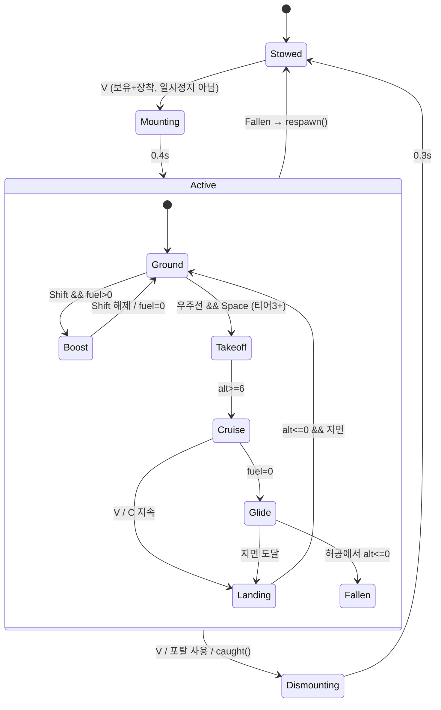
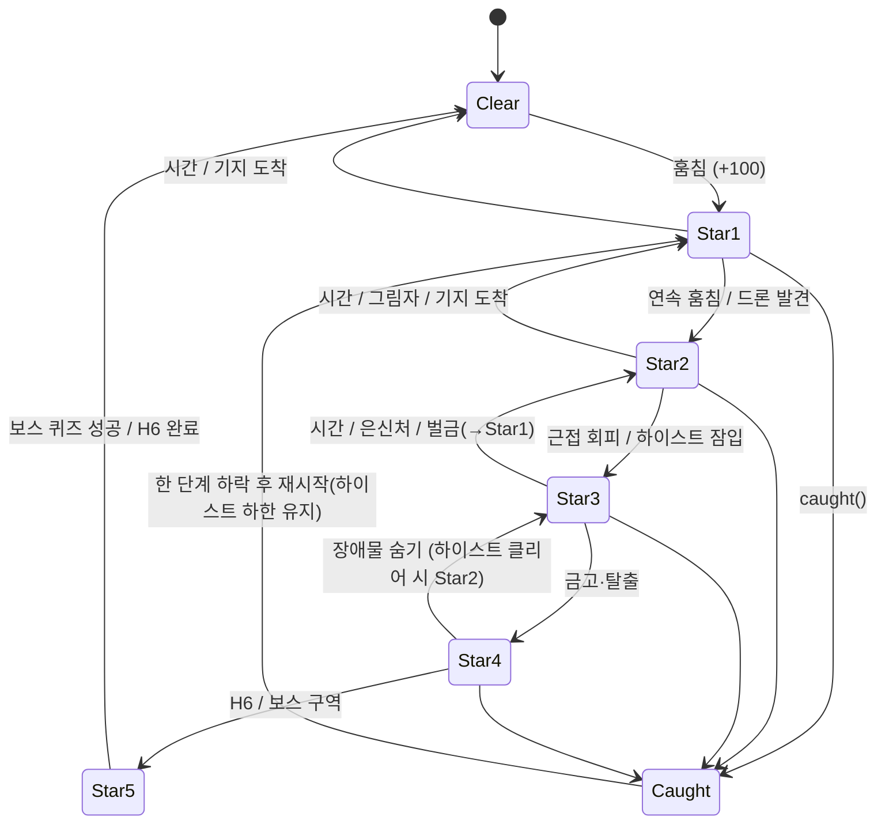
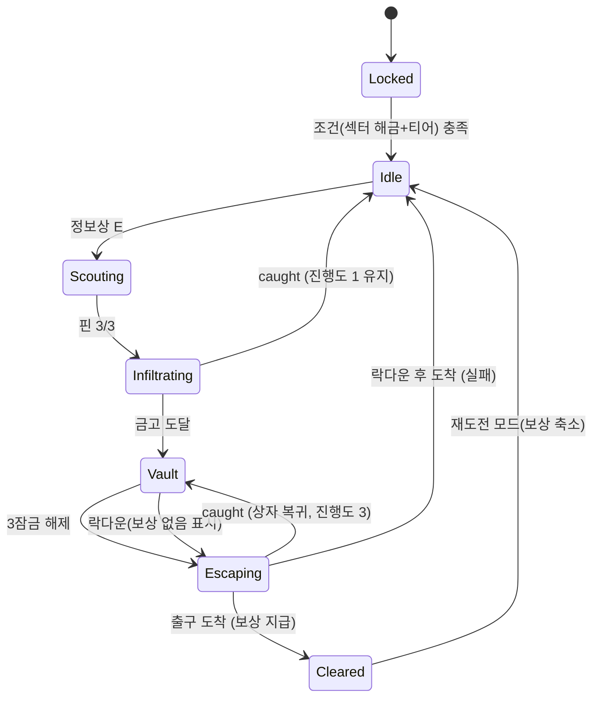

# 게임플레이 시스템 상세 기획 — M2(이동 수단) · M3(수배 + 하이스트)
> 상위 문서: [CONTENT_PLAN.md](CONTENT_PLAN.md) 3·4·5장(표의 골격), [STORY.md](STORY.md) 2·5장(무문자·시선 수호신), [ROADMAP.md](ROADMAP.md) M2/M3, [CLIENT.md](CLIENT.md) 레지스트리·세이브 v5.
> 이 문서는 위 표를 **구현 가능한 규칙·수치·타입**으로 풀어 쓴다. 수치는 초안이며 최종값은 `data/pacing.ts` 한 곳에서 조정한다(ROADMAP "실측 먼저" 원칙).
> 표기: **S1~S12** = CONTENT_PLAN의 구역 번호. CLIENT.md의 현재 섹터 id(solar, exo, …)와 순서가 다르므로 **id 매핑은 ❓1**.

## 0. 설계 원칙 (공통)
1. **무문자**: HUD·월드 안내는 아이콘/모양/색/소리/진동 연출만. 글이 허용되는 곳은 퀴즈·상점 품목명·도감뿐(STORY 2장). 이 문서의 모든 "표시"는 아이콘이다.
2. **색만 쓰지 않기**: 단계 구분은 색 + 모양(개수·형태) 병행.
3. **데이터 주도**: 수치는 `data/vehicles.ts`, `data/wanted.ts`, `data/heists.ts` 테이블. 시스템 코드는 테이블을 읽기만 한다.
4. **세이브는 작게**: `id → 작은 숫자` 맵 유지(CLIENT.md, PUT 상한 256KB). 런타임 상태(연료, 드론 위치 등)는 저장하지 않는다.
5. **기존 루프 보존**: `caught()`, `respawn()`, `gravityNow()`, 수호자 AI의 의미를 바꾸지 않고 **배율·훅만 추가**한다.
---

## 1. 이동 수단 (M2)
### 1.1 단계별 스펙
| 티어 `S.vehicle` | 수단 | 해금 조건 | 속도 배율 `speedMul` | `hover()` | 핵심 효과 | 소모 자원 |
|---|---|---|---|---|---|---|
| 0 | 걷기 | 시작 | ×1.0 | false | 현행(스태미나 달리기 ×1.7) | 스태미나 |
| 1 | 점프팩 | S2 퀘스트(렌치의 부품 3개 수집) + 구매 | ×1.0 | 홀드 중만 true | 2단 점프, Space 길게 = 짧은 호버(최대 2.0초) | 연료 |
| 2 | 호버보드 | S4 진입 + 렌치 구매 + 점프팩 보유 | ×2.2 (지상) | false | 빙판 마찰 무시, 강풍 저항, 허공은 못 건넘(낙하 → `respawn()`) | 연료(부스트만) |
| 3 | 소형 우주선 | S6 우주선 퀘스트 + 구매 | 순항 ×3.0 / 부스트 ×4.5 | **true** | 고도 6~40, **허공 횡단**, 섹터 간 직선 이동 | 연료 |
| 4 | 워프 드라이브 | H3(S10) 클리어 보상 "워프 코어" 장착 | 우주선과 동일 | 우주선과 동일 | 방문한 포탈로 즉시 이동(기존 포탈 UI 재사용) + 허공 중간 워프 불가 | 워프 충전 1칸(쿨다운 90초) |
| 5 | 중력 글라이더 | H4(S11) 클리어 보상 | 순항 ×3.4 | **true** | 강중력(×1.4 이상)·시간 지연 구역에서 우주선의 페널티 제거 | 연료 |

- **누적 규칙**: 상위 티어를 얻어도 하위 수단은 유지, 장착 선택 가능(`vehicles.eq`). `S.vehicle` = 보유 최고 티어(섹터 `requires.vehicle` 판정용).
- **섹터 `requires.vehicle` 정렬**: CLIENT.md 표는 `이동 수단 1/2/3`으로 쓰고 있다. 위 티어와 일치시키면 7·8·9 → 1, 10·11 → 2, 12 → 3으로 읽힌다. **하이스트 보상 티어(4, 5)는 섹터 조건에 쓰지 않는다**(편의 수단이지 필수 관문이 아님). ❓2
- **우주선 제약(밸런스)**:
  - 강중력 섹터(`gravityMul ≥ 1.4`, S10·S11): 순항 ×2.2, 연료 소모 ×2, 최대 고도 20. 글라이더는 제한 없음.
  - **잠긴 섹터 위는 못 난다**: `blockedAt` 벽은 비행에도 적용(고도 무관 투명 벽, 닿으면 튕김 + 잠금 아이콘 깜빡). 문 시험을 우회 불가.
  - 들고 있는 행성이 있으면 속도 페널티 `1 + ve/220`은 우주선에서 **절반**만 적용(배달 보상).
  - 비행 중 행성 훔치기/내려놓기 불가 — 착륙(`V`) 후에만 상호작용(수호자와 거리 두고 훔치는 "착륙 → 훔치기 → 이륙" 리듬 유도).
- **업그레이드**(상점 sink, 렌치): `spd`(속도 +5%/Lv, 최대 Lv5), `fuel`(연료 통 +20%/Lv), `cargo`(비행 중 운반 가능 칸 수 +1, 최대 Lv3). 가격은 `pacing.ts`.

### 1.2 조작
| 동작 | PC | 모바일(아이콘 버튼) |
|---|---|---|
| 탑승/하차 | `V` | 🛹/🚀 토글 버튼 |
| 상승(점프팩 호버, 우주선) | `Space` 유지 | ⬆ 버튼 |
| 하강(우주선) | `C` | ⬇ 버튼 |
| 부스트 | `Shift` 유지(탑승 중엔 스태미나 달리기 대신 **연료**) | ⚡ 버튼 |
| 착륙(우주선) | 고도 6 이하에서 `V`, 또는 지면 위 하강 지속 | 🛬 버튼 |
| 워프(티어4) | 포탈 패드 없이 `G` → 포탈 목록 오버레이 | 🌀 버튼 |

- 탑승 중에는 **스태미나 달리기 비활성**(배율 이중 곱 방지). 점프팩은 지상 달리기 가능(속도 ×1.0이므로).
- 키 충돌 확인 필요(`C`, `G`, `V` 미사용 여부는 `input.ts` 점검). ❓3

### 1.3 연출 (글 없음)
- **탑승**: 0.4초 소환 이펙트(바닥에 원형 파동 → 기체가 캐릭터 아래에서 펼쳐짐). 하차는 역재생.
- **점프팩**: 등 뒤 불꽃 파티클, 연료 게이지는 **캐릭터 머리 위 호(arc) 아이콘**(스태미나 바와 모양이 다름).
- **호버보드**: 지면에 청색 빛줄기 + 발광 궤적(속도에 비례해 길어짐), 빙판에서 불꽃이 아닌 물결 무늬로 "미끄러지지 않음" 표시.
- **우주선**: 이륙 시 카메라 거리 +30%·FOV 상승, 속도선(streak) 파티클. 고도계는 숫자 없이 **지면 그림자 크기**와 우측 세로 막대(고도 위치 점).
- **연료 부족**: 게이지가 비면 붉은 깜빡임 + 경고음 3회 → 강제 하강(우주선은 활강 속도 ×0.6로 가장 가까운 지면으로 자동 조향). **허공 위에서 연료가 다 떨어지면** 활강으로 지면에 닿지 못하면 `respawn()`(돈 손실 없음, 행성 제자리).
- **워프**: 화면 가운데로 빨려드는 줄무늬 0.6초 → 도착 지점에서 역재생. 쿨다운은 🌀 아이콘이 시계 방향으로 채워짐.
- **정비사 렌치(NPC)**: 머리 위 🔧 아이콘, 구매는 기존 상점 UI(품목명·가격만 글). 부품 퀘스트는 아이콘 요구 3개(⚙⚙⚙)가 칸에 채워지는 방식.

### 1.4 상태 `S.vehicle` / `S.vehicles` / 런타임
- 저장: `S.vehicle`(보유 최고 티어, 숫자), `S.vehicles`(맵: `own1..own5`=보유 1, `eq`=장착 티어, `spd/fuel/cargo`=업그레이드 Lv, `warp`=워프 마지막 사용 시각의 분 단위 절대값이 아니라 **0/1 충전 여부**).
- 런타임(비저장): `mounted`, `fuel`(0~100), `alt`(우주선 고도), `warpCd`(초), `boosting`.
- 로드 시: 항상 **하차 상태**로 시작, 연료 가득(저장 복원이 어색한 위치 문제 방지).
---

## 2. 수배(경계도) 시스템 (M3-a)
### 2.1 모델
- `S.wanted` = **열기(heat) 0~500의 정수**. 별 수 `stars = ceil(heat / 100)` (0이면 0성). 숫자 구간으로 저장해 시간 경과 감쇠를 연속 처리하고, UI는 별(눈) 단계만 보인다.
- 상승은 이벤트 가산, 하락은 초당 감쇠 + 특수 행동. 하이스트·보스는 **하한(floor)** 을 걸어 내려가지 않게 한다.
- 잡힘(`caught()`) 손실률: 기존 5%/15% × `(1 + 0.25 × stars)`, 상한 40%. 잡히면 열기는 **한 단계 내려간다**(`heat = max(0, (stars-1)*100)`)가 하이스트 중이면 하한 유지.

### 2.2 단계별 규칙 표
| 별 | 열기 구간 | 상승 조건 | 하락 조건 | 수호신/적 반응 | 시각 표현 |
|---|---|---|---|---|---|
| 0 | 0 | — | — | 평소(구역 수호자 추격형 + 섹터 사이 숨바꼭질형) | 눈 아이콘 감김(회색, HUD 숨김) |
| ★1 | 1~100 | 행성을 훔침 +100 | 시간 -2/s(약 50초) · 기지 도착 시 즉시 0 | 수호자 속도 +10% | 반쯤 뜬 눈 1칸 · 노란색 · 화면 변화 없음 |
| ★2 | 101~200 | 60초 내 연속 훔침 +100 · 드론에게 발견 +30/s | 시간 -1/s · 그림자 지대 -4/s · 기지 도착 시 100으로 | 수호자 +15%, **감시 드론** 구역당 1기 공중 순찰(시야 원뿔 18m, 발견 시 수호자를 해당 위치로 호출) | 눈 2칸 · 주황 · 드론 머리 위 ◇ 아이콘 + 원뿔 바닥 표시 |
| ★3 | 201~300 | 수호자 근접 회피(5m 이내, 쿨 3초) +50 · 하이스트 잠입 중 하한 | 시간 -0.5/s · 그림자 -3/s · 은신처 안 -8/s · **벌금**(해결사 NPC, 보유금 3%) → 100으로 | 수호자 +20%, **추적자** 1기(속도 = 걷기 기본 ×1.05, 직선 추적, 3초 접촉 시 `caught()`) | 눈 3칸 · 붉은색 · 추적자 △ 아이콘 · 화면 가장자리 약한 맥동 |
| ★4 | 301~400 | 하이스트 금고 단계·탈출 중 하한 · 드론에 연속 노출 | **시간 감쇠 없음** · 장애물 뒤 시야 차단 5초 지속 시 -6/s · 하이스트 클리어 시 200으로 | 수호자 +25%, **순찰선**(비행체, 우주선 순항 ×0.9) 추격: 비행 중에도 따라붙음 | 눈 4칸 · 진홍 · 순찰선 ▣ 아이콘 · 비네트 맥동 + 심장 박동음 |
| ★5 | 401~500 | H6 탈출 개시 · 보스 구역 진입 | **감쇠 없음** · 보스 격파 퀴즈 성공 / H6 완료 시 0 | 수호자 +30%, **사령관**(구역 보스: 느리지만 시야각 넓음, 순간이동 점프) | 눈 5칸 + 불꽃 · 화면 테두리 붉은 번쩍 · 음악 템포 상승 |

- **은신 지형**(구역 고유): 그림자 지대(S7 쌍성 그림자), 안개(S9 성운), 장애물 뒤. `Sector.hideout?: Rect[]`를 데이터로 둔다. 은신처(건물 아이콘 🕳)는 수호자 시야 판정에서 제외 + 감쇠 가속.
- **시선 수호신과의 관계**(STORY 5.1): 숨바꼭질형이 플레이어를 **닿으면** `caught()`와 동일 처리(열기 +50 가산 후 처리). 바라보고 있으면(시야 내) 열기는 오르지 않는다.
- **기지 안(`inBase`)**: 수호자/드론은 들어오지 못하지만 열기 감쇠는 ★2 이하만 즉시 적용. ★3 이상은 기지에 숨어도 **그 값을 유지하며 천천히(-1/s) 식음**(안전지대 남용 방지). ❓4
- **라이벌 침입**(`rival`)과 독립. 라이벌을 막으면 열기 -30(작은 보상, 선택).

### 2.3 HUD 레이아웃
- 좌상단 `#lines`에 **눈 아이콘 줄**(`wantedSystem.hud()`): 5칸 눈꺼풀 막대. 칸 수 = 별 수, 아이콘 내부 홍채 크기 = 구간 내 열기 비율(다음 별까지 얼마나 남았는지).
- 하락 중이면 눈이 **서서히 감기는 애니메이션**, 상승 시 번쩍 + 소리. 기지 위에서는 눈에 🏠 배지.
- 접근성: 별마다 **눈 모양이 달라진다**(반개 → 전개 → 충혈선 → 불꽃 눈동자) — 색을 못 봐도 모양으로 구분.
---

## 3. 하이스트 6개 (M3-b)
### 3.1 공통 구조
- **4단계**: 정찰 → 잠입 → 연속 퀴즈 금고 → 탈출 추격. 각 단계 약 3분, 합계 **약 12분**(이동 포함).
- **시작**: 구역 안 **정보상 NPC**(머리 위 🕶)에게 말을 걸면 시작. 정보상은 아이콘 지도(핀 3개)만 보여준다.
- **정찰**: 월드 위 핀 3개(🔍)를 모두 방문(근접 3m + E). 순서 무관. 핀마다 간단한 관찰 과제(경비 패턴을 눈으로 보기)가 있어 **잠입 시 경로 힌트**가 된다(다음 단계의 안전 경로 표시 선이 부분 노출).
- **잠입**: 하이스트 전용 구역(`HeistZone`, 구역 안의 사각형)에 진입. 열기 하한 ★3(H6는 ★4).
- **금고**: 잠금 3개. 잠금마다 퀴즈 1문(연속 3문). 오답 1회 = 경보(열기 +100, 경비 증원 1) 후 같은 잠금에서 다른 문제 재시도, 오답 **누적 3회 = 락다운**(금고 닫힘, 탈출 단계 강제 시작 + 전리품 없음, "실패" 처리 → 3.8).
- **탈출**: 금고에서 가져온 보상 오브젝트(빛나는 상자)를 들고(운반 규칙은 행성과 같음 → 속도 페널티) **출구 마커(🚪)** 까지 가야 한다. 열기 ★4, 추격 연출.
- **퀴즈 연동**: `QuizCtx`에 `heist: id` 컨텍스트를 추가해 기존 퀴즈 UI 재사용. 문제는 `GQU` 중 해당 `units` 태그에서 뽑되 **이미지 문제 우선**(STORY 10장), 해설 1문장. 정답 시 자물쇠가 풀리는 애니메이션(열쇠 구멍 모양이 문제 주제와 연관된 도형).
- **보상**: 1회성 보상(최초 클리어) + 재도전 모드 보상(코인 `S.coins` 소량 + 도감 진행 없음).
- **세이브 체크포인트**: `S.heists[id]`(진행도) — 3.8 참고.

### 3.2 H1 — 목성 방사선 터널 (S3)
| 항목 | 내용 |
|---|---|
| 목표 | 방사선 터널 끝의 금고에서 "방호 코어"를 가져온다 |
| 구역 | 목성계 S3, 위성 사이의 터널형 구간(길쭉한 `HeistZone`) |
| 단계 | ① 정찰 핀 3개(터널 입구·중간 점검구·금고 문)에서 방사선 파동 주기 관찰 ② 잠입: 터널을 파동 사이 틈으로 통과(방사선 구간 = 회전 부채꼴, 닿으면 화면 흰 번쩍 + 속도 ×0.5, 3초 누적 시 `caught`) ③ 금고 3문 ④ 탈출: 같은 터널을 역주행, 파동 속도 +30% + 수호자 추격 |
| 위험요소 | 회전 방사선 부채꼴, 방호복 게이지(시간제 피해), 점프팩으로만 오르는 단차 |
| 퀴즈 | 중력·궤도: 위성 궤도 그림 고르기, 케플러 법칙 그림(속도↔거리 선택) |
| 필요 이동 수단 | 점프팩(티어 1) |
| 보상 | 방호복 업그레이드(방사선 면역 시간 +50%), 최초 클리어 코인 |

### 3.3 H2 — 뜨거운 비 속의 금고 (S8)
| 항목 | 내용 |
|---|---|
| 목표 | 뜨거운 비가 쏟아지는 평원 한가운데 금고를 연다 |
| 구역 | 뜨거운 목성들 S8, 평원 + 중앙 금고 돔 |
| 단계 | ① 정찰: 비 구역(💧 파란 방울)과 마른 구역(☂ 지붕) 위치 파악 ② 잠입: 지붕 패드 사이를 이동 — 비를 맞는 시간이 방열복 게이지를 깎음, 게이지 0이면 지붕 패드로 강제 귀환 ③ 금고: 상태 변화 퀴즈(고체·액체·기체 순서 맞추기) ④ 탈출: 비가 증발 구름으로 바뀌어 시야 저하, 순찰 드론 다수 |
| 위험요소 | 뜨거운 비(시간제 피해), 증발 구름(시야), 미끄러운 젖은 바닥(호버보드 유리) |
| 퀴즈 | 산화·상태 변화: 얼음→물→수증기 순서 카드, 열 이동 그림 |
| 필요 이동 수단 | 호버보드(티어 2) 권장(필수 아님: 걸어서도 가능하나 제한 시간 빡빡) |
| 보상 | 방열복, 유니크 행성 1종("증발하지 않는 유리 행성" 가칭, ❓5) |

### 3.4 H3 — 펄서의 심장 (S10)
| 항목 | 내용 |
|---|---|
| 목표 | 펄서의 자기장 한가운데 "심장"(워프 코어)을 가져온다 |
| 구역 | 초신성 잔해·죽은 별 S10, 중심에 펄서 + 등대처럼 회전하는 빔 |
| 단계 | ① 정찰: 빔 회전 주기를 3개 지점에서 관찰 ② 잠입: 빔의 그림자 안으로만 이동(빔 = 거대한 회전 선, 맞으면 `caught`), 자기장 교란으로 **조작이 주기적으로 좌우 반전** ③ 금고: 별의 일생 순서 퀴즈 ④ 탈출: 빔 속도 증가 + 우주선 순찰 |
| 위험요소 | 회전 빔, 조작 교란(입력 반전 0.7초 경고음 후 3초), 강중력 ×1.4 |
| 퀴즈 | 별의 일생: 성운→주계열→적색거성→초신성→중성자별 순서 맞추기 (이미지 카드) |
| 필요 이동 수단 | 우주선(티어 3) 필수 — 빔 아래로 낮게 날아 통과하는 구간 |
| 보상 | **워프 코어 → 이동 수단 티어 4 해금**, 최초 클리어 코인 |

### 3.5 H4 — 강착원반 통과 (S11)
| 항목 | 내용 |
|---|---|
| 목표 | 블랙홀 강착원반의 회전 고리를 건너 중심부 금고를 연다 |
| 구역 | 가르강튀아 S11, 블랙홀 + 고리형 플랫폼 |
| 단계 | ① 정찰: 고리 회전 방향·속도를 핀에서 관찰 ② 잠입: 회전하는 고리 플랫폼을 건너뜀(타이밍 점프), 가장자리에서 **중력 파동**(주기적 끌림), 구역 내 `timeMul ×3`이라 기지 수익은 빠르지만 하이스트 타이머도 빠르게 흐르는 연출 ③ 금고: 중력 개념 퀴즈 ④ 탈출: 고리가 빨라지고 파동 강해짐 |
| 위험요소 | 회전 플랫폼, 중력 파동(밀림 벡터), 낙하 = `respawn()` |
| 퀴즈 | 중력 개념: 질량·거리에 따른 힘 크기 그래프 고르기, 탈출 속도 그림 |
| 필요 이동 수단 | 우주선(티어 3) — 우주선은 강중력 페널티를 받으므로 **불편함 자체가 보상 동기** |
| 보상 | **중력 글라이더(티어 5)** |

### 3.6 H5 — 수호신의 사원 (S12)
| 항목 | 내용 |
|---|---|
| 목표 | 사원 깊은 곳 제단의 장식·장비를 가져온다 |
| 구역 | 알파 센타우리·판도라 S12, 사원 내부 방 4개 |
| 단계 | ① 정찰: 석상(수호신 조각) 3개의 위치와 움직임 규칙 확인 ② 잠입: **시선 수호신 규칙을 퍼즐로 응용** — 바라보는 동안 석상이 멈추고, 등지면 다가온다. 방마다 석상 2~3개를 시야로 가두며 통과 ③ 금고: 에너지·생태 퀴즈(먹이 사슬 그림, 에너지 흐름) ④ 탈출: 석상이 전부 깨어나 추격, 발광 식물(밤 발광)을 따라 길 찾기 |
| 위험요소 | 시선형 석상(`watcher` 규칙 재사용), 독가스 구간, 0.8g, 밤에 적대 생물 |
| 퀴즈 | 에너지·생태: 먹이 사슬 순서, 광합성/에너지 전환 그림 |
| 필요 이동 수단 | 없음(실내). 글라이더 보유 시 입구 지름길만 |
| 보상 | 사원 장식(기지 꾸미기), 유니크 장비 1종 |

### 3.7 H6 — 삼연 행성, 마지막 한탕 (마지막 섹터)
| 항목 | 내용 |
|---|---|
| 목표 | 3연 행성 둥지(`kind: 'triple'`)에서 3개를 한 번에 훔쳐 기지에 도착 |
| 구역 | 마지막 섹터(STORY 9장) |
| 단계 | ① 정찰: 전용 가방 확인(요구: 운반 `cap ≥ 3` — 선행 가방 업그레이드) + 경로 핀 3개 ② 잠입: 둥지까지 접근. 열기 하한 ★4, 하이스트 최종 구역은 이전 하이스트 장치(빔·회전·시선) **혼합** ③ 금고 대신 **연속 퀴즈 3문**(에너지 종합, 잠금 3개) — 정답마다 3개 행성 중 하나가 둥지에서 풀림 ④ 탈출: **전용 추격전**(수호자 속도 배수, 사령관 ★5), 성공 조건 = 기지 도착 |
| 위험요소 | 모든 위험 혼합, 추격 중 장애물 연출(STORY 5.4), 사령관 순간이동 |
| 퀴즈 | 에너지 종합(핵융합·발전·보존) 이미지 문제 위주 |
| 필요 이동 수단 | 우주선 이상 권장, 추격 중엔 **하차 불가**(기체 고정) |
| 보상 | 스토리 진행: `S.story.beat` +1(추격 → 기지 도착 비트로 컷신 연결). 행성 3개는 컷신 후 STORY 규칙대로 처리 |

### 3.8 실패 / 재시도 규칙
| 상황 | 처리 | 진행 보존 |
|---|---|---|
| 정찰·잠입 중 `caught()` | 기지로 복귀, 기존 돈 손실 규칙 적용 | 정찰 완료 상태 유지(핀 재방문 불필요) |
| 금고 오답 누적 3회(락다운) | 금고 닫힘 → 탈출 단계 강제 시작(보상 없음). 탈출 성공해도 "실패" | 진행도를 잠입 완료(2)로 되돌림, 퀴즈 문제 재추첨 |
| 탈출 중 `caught()` | 전리품 상자 둥지로 복귀(금고 앞에 다시 생성) | 금고 해제 상태(3) 유지: 상자만 다시 들고 탈출 |
| 제한 시간(단계 타이머) 초과 | 단계 시작점으로 순간 복귀(감점 없음) | 단계 진행 유지 |
| 완전 이탈(구역 밖으로 나감) | 하이스트 일시 중지(재진입 시 단계 시작점에서 재개) | 진행도 유지 |
| 클리어 후 | 정보상에서 **재도전 모드**(보상 = 코인만, 도감·유니크 없음, 열기 규칙 동일) | `H#` 클리어 횟수 +1 |

- 하이스트 중 `respawn()`(허공 낙하)은 하이스트 단계 시작점으로 복귀(허브 스폰 아님).
- 하이스트 활성 중에는 **포탈·워프 사용 불가**(아이콘 🚫), 이탈 사유 최소화.
---

## 4. 상태 머신
### 4.1 이동 수단


- `speedMul()` = Stowed 1.0 / Active는 티어표 × `spd` 업그레이드 / Glide ×0.6. `hover()` = Cruise·Takeoff·Landing·Glide 중 true.

### 4.2 수배


### 4.3 하이스트

---

## 5. 데이터 구조 초안 (TypeScript)
CLIENT.md 규칙: `core/types.ts`에 필드 선언 + `save-schema.ts` `defaults()`의 빈 기본값(이미 `wanted: 0, vehicle: 0, vehicles: {}, heists: {}`). **v5 안에서 의미 해석만 정의하므로 `SAVE_VER` 변경 없음**(v6은 STORY의 `story` 추가 시점).

```ts
// ── 이동 수단 (data/vehicles.ts) ─────────────────────────
export type VehicleTier = 0 | 1 | 2 | 3 | 4 | 5;
export interface VehicleDef {
  tier: VehicleTier;
  id: 'walk' | 'jetpack' | 'hoverboard' | 'ship' | 'warp' | 'glider';
  icon: string;                      // HUD/탑승 아이콘 (글 없음)
  speed: number;                     // 지상/순항 배율
  boost: number;                     // 부스트 배율 (1 = 없음)
  hover: 'none' | 'hold' | 'free';   // none=지상 / hold=Space 홀드 호버 / free=자유 비행
  altRange?: [number, number];       // free 일 때 고도 범위
  ignoreIce: boolean;
  fuelMax: number;                   // 0 = 연료 없음
  fuelDrain: {idle: number; boost: number};   // 초당
  heavyGravPenalty: {speedMul: number; drainMul: number; altCap?: number};  // gravityMul>=1.4
  cargoSlots: number;
  unlock: {sector: string; quest?: string; heist?: string; price: number};
}
// S.vehicles 키 규약 (값은 모두 작은 정수)
export type VehiclesSave = Record<
  'own1' | 'own2' | 'own3' | 'own4' | 'own5' | 'eq' | 'spd' | 'fuel' | 'cargo' | 'warp', number>;
export interface VehicleRuntime {
  mounted: boolean; fuel: number; alt: number; boosting: boolean; warpCd: number;
  phase: 'stowed'|'mounting'|'ground'|'boost'|'takeoff'|'cruise'|'landing'|'glide'|'dismounting';
}

// ── 수배 (data/wanted.ts) ───────────────────────────────
export type Stars = 0 | 1 | 2 | 3 | 4 | 5;
export interface WantedTier {
  stars: Stars;
  maxHeat: number;                         // 100*stars
  decay: {time: number; shadow: number; hideout: number; hidden: number};  // /s, 0 = 없음
  guardMul: number;                        // 수호자 속도 배율
  spawn: ('drone'|'chaser'|'patrol'|'commander')[];
  lossRate: number;                        // caught() 손실 배율
  icon: string;                            // 눈 모양 id (색과 별개)
}
export type WantedEvent =
  | {t: 'steal'} | {t: 'chain'} | {t: 'near'} | {t: 'drone', dt: number}
  | {t: 'alarm'} | {t: 'rivalBlocked'} | {t: 'base'} | {t: 'fine'} | {t: 'bossClear'};
export interface WantedRuntime {
  heat: number; floor: number;             // floor: 하이스트 하한
  lastStealAt: number; nearCd: number; hidden: number;
  actors: {id: number; kind: 'drone'|'chaser'|'patrol'|'commander'; x: number; z: number; sector: number}[];
}
// S.wanted = Math.round(heat)

// ── 하이스트 (data/heists.ts) ───────────────────────────
export type HeistId = 'H1' | 'H2' | 'H3' | 'H4' | 'H5' | 'H6';
export type HeistStage = 'idle' | 'scout' | 'infiltrate' | 'vault' | 'escape' | 'cleared';
export interface HeistDef {
  id: HeistId;
  sector: string;                           // 섹터 id (❓1 매핑)
  requires: {vehicle?: VehicleTier; stars?: Stars; cap?: number; prev?: HeistId};
  informant: {x: number; z: number};
  pins: [Pt, Pt, Pt];                       // 정찰 핀
  zone: {rect: Rect; floorStars: Stars};
  hazards: HazardDef[];                     // 종류별: sweep | rain | beam | ring | statue | gas
  vault: {locks: 3; units: string[]; maxWrong: 3; imageFirst: boolean};
  escape: {exit: Pt; guardMul: number; patrol: boolean; timer?: number};
  reward: {first: RewardDef[]; replay: {coins: number}};
  budgetSec: 720;                           // 목표 12분 (텔레메트리 비교용)
}
// S.heists 키 규약: 'H1'=진행도 0..4 (0 미시작,1 정찰완료,2 잠입완료,3 금고열림,4 클리어) / 'H1#'=클리어 횟수
export interface HeistRuntime {
  id: HeistId | null; stage: HeistStage; pins: number;   // 비트마스크 3비트
  wrong: number; locksOpen: number; loot: boolean; t: number;
}
type Pt = {x: number; z: number}; type Rect = {cx: number; cz: number; w: number; h: number};
```

### 5.1 `GameSystem` 확장 포인트 사용 / 필요한 추가
| 시스템 | 현재 훅으로 되는 것 | **필요한 최소 추가**(코드 변경은 구현 단계에서) |
|---|---|---|
| `vehicle` | `speedMul()`(속도), `hover()`(비행), `update`(고도·연료, `G.me.pos.y`), `onSave/onLoad`, `hud`(연료 아이콘) | 이동 보정 훅 `moveMod?(): {ice?: boolean; jump?: number; noRun?: boolean}` — `movePlayer`가 빙판 무시·점프 배율·스태미나 달리기 차단을 읽는다 |
| `wanted` | `update`(감쇠·액터 AI), `hud`, `onSectorEnter/Leave`(드론 생성/해제), `onSave/onLoad` | ① `guardMul?(): number` — `updateGuardians`가 `s.guard.speed`에 곱 ② `onCaught?(): void` — `caught()`가 호출(손실률 배율은 `lossMul?()`) ③ 훔침 이벤트 `onSteal?` — `nest` 상호작용 성공 지점에서 |
| `heist` | `update`(단계 타이머·위험요소), `onSectorEnter`, 상호작용 `informant/pin/vault/exit`, `hud`(단계 아이콘) | 퀴즈 컨텍스트에 `heist` 필드 + 포탈 차단 `portalBlocked?(): boolean` |

- 등록 순서(`systems/index.ts`): `hazards → rival → portal → vehicle → wanted → heist`. `vehicle`이 `wanted`보다 앞(비행 상태를 먼저 갱신), `heist`가 마지막(둘의 값을 읽어 하한·차단을 적용).
- 상호작용 kind: `mechanic`(렌치), `informant`, `pin`, `vault`, `exit`, `fixer`(벌금 해결사). 모두 `registerInteractable`, 메시에 `userData.pick`.
- 디버그: `?debug=1` `__game`에 `setVehicle(tier)`, `setWanted(heat)`, `startHeist(id, stage?)`, `forceWrong(n)` 추가.
---

## 6. 구현 순서와 수용 기준
### 6.1 순서 (각 단계는 독립 병합 가능)
| 단계 | 내용 | 마일스톤 |
|---|---|---|
| A | 타입·`defaults`·데이터 테이블 뼈대, 디버그 훅 | M2 |
| B | `vehicle` 시스템: 점프팩 + 호버보드(지상 수단), 렌치 NPC·상점, 탑승 연출 | M2 |
| C | 우주선(허공 횡단, 연료, 강중력 페널티, 잠금 벽), 업그레이드 | M2 |
| D | 워프/글라이더(보상 연동은 H3/H4 이후 활성) | M2 후반 |
| E | `wanted` 코어: 열기 가감, 눈 HUD, `caught()` 배율 연동 | M3 |
| F | 수호자 배율, 드론·추적자·순찰선·사령관 액터 | M3 |
| G | 하이스트 프레임워크 + **H1 수직 슬라이스**(정찰/잠입/금고/탈출 전부) | M3 |
| H | H2~H5(위험요소 모듈 재사용: sweep·rain·beam·ring·statue) | M3 |
| I | H6 + 스토리 비트 연결(M4의 `story.ts`와 합류) | M3~M4 |
| J | 밸런스(12분 실측 보정), 12분 텔레메트리 | M7 |

### 6.2 수용 기준 (테스트 가능)
**이동 수단**
- A1. `__game.setVehicle(2)` 후 `V`를 누르면 0.4초 후 `speedMul()`이 `2.2 * (1 + 0.05 * spd)`와 같다(오차 ±0.001).
- A2. 호버보드 탑승 중 허공으로 걸어 들어가면 `respawn()`이 호출되고 `S.cr`이 변하지 않는다.
- A3. 우주선 탑승 중 `hover()`가 true이고, 허공 위를 10초 비행해도 `respawn()`이 호출되지 않는다.
- A4. 연료가 0이 되면 우주선 `speedMul()`이 0.6 이하가 되고 고도가 단조 감소한다.
- A5. 잠긴 섹터 경계는 고도 40에서도 통과할 수 없다(`blockedAt` 유지).
- A6. 탑승 중에는 `Shift`를 눌러도 `G.stam`이 감소하지 않는다.
- A7. 세이브 후 새로고침하면 `vehicles.eq`/`vehicle`은 유지되고 `mounted`는 false다.
- A8. `S.vehicle` 값을 올리면 `requires.vehicle`이 해당 값인 섹터의 `reqMissing`에서 vehicle 항목이 사라진다.

**수배**
- B1. 행성을 훔치면 `S.wanted`가 100 이상이 되고 HUD 눈이 1칸이다.
- B2. 아무것도 하지 않을 때 ★1에서 60초 안에 0이 된다(감쇠 -2/s ±10%).
- B3. ★2 이상에서 활성 섹터에 감시 드론이 정확히 1기 존재하고, 섹터를 떠나면 해제된다.
- B4. ★4에서는 시간이 지나도 `S.wanted`가 감소하지 않는다(숨기 제외).
- B5. 같은 상태에서 `caught()` 시 손실액이 `floor(cr * base * (1 + 0.25*stars))`(상한 40%)와 일치한다.
- B6. 해결사에게 벌금을 내면 `S.cr`이 3% 줄고 열기가 100이 된다(★3 이상에서만).
- B7. HUD에 문자가 렌더되지 않는다(`#lines`의 wanted 줄에 텍스트 노드 없음).

**하이스트**
- C1. 정보상 상호작용으로 `S.heists.H1`이 0 → 시작되고 핀 3개 방문 후 1이 된다.
- C2. 금고에서 오답 2회까지는 락다운이 아니고, 3회째에 탈출이 강제 시작되며 클리어해도 보상이 지급되지 않는다.
- C3. 탈출 중 `caught()` 후 `S.heists.H1`이 3이고, 상자가 금고 앞에서 다시 들 수 있다.
- C4. 클리어 시 `S.heists.H1 === 4`, `H1#` 이 1 증가, 보상이 정확히 1회 지급된다. 재도전 시 `first` 보상은 지급되지 않는다.
- C5. 하이스트 활성 중 포탈 사용이 차단된다.
- C6. H3 클리어 직후 `S.vehicle >= 4`, H4 클리어 직후 `S.vehicle === 5`.
- C7. 사전 정의된 봇(정답 경로 + 이상적 이동)이 각 하이스트를 270~900초(목표 720초)에 클리어한다(E2E 하네스, 수치 보정용).
- C8. 로드된 세이브에서 하이스트 진행도 1~3은 해당 단계 시작점에서 재개된다(위치 복원 아님).
---

## 7. 결정할 것 ❓
| # | 질문 | 추천 |
|---|---|---|
| 1 | CONTENT_PLAN S1~S12 번호와 CLIENT.md 현재 섹터 id/순서가 다르다. 매핑 기준은? | CONTENT_PLAN 기준으로 `data/sectors.ts` 재정렬(M5 콘텐츠 투입 때), 그 전까지 `HeistDef.sector`는 id 문자열 매핑 표를 한 곳에 둔다 |
| 2 | `requires.vehicle` 숫자를 티어와 직접 맞출까, 별도 "기능"(허공 횡단) 플래그로 분리할까? | 티어 직접 사용 + 4·5티어는 편의용(조건에 안 씀) |
| 3 | 키 `V/C/G` 충돌 점검 및 모바일 버튼 배치 | `input.ts` 점검 후 확정, 비행 버튼은 우하단 세로 배치 |
| 4 | ★3 이상에서 기지는 "안전지대"인가? | 안전하되 열기는 느리게 식는다(-1/s) — 현재안 |
| 5 | H2의 유니크 행성 종류와 이름(교육 콘텐츠 연계) | M5 행성 80종 확정 시 하나 배정 |
| 6 | 호버보드를 "행성 운반 중에도" 쓸 수 있나? | 가능, 단 페널티 현행 유지(우주선만 절반) |
| 7 | 시선 수호신(숨바꼭질)과 구역 추격형 수호자의 공존 방식 | 공존(STORY ❓3 따름): 열기는 둘 다 올린다 |
| 8 | 점프팩을 이동 수단(티어1)으로 넣을지 신발 장비로 둘지 | 티어1 유지(해금 흐름 일관성), 신발 `spd`와 별개 |
| 9 | 퀴즈 오답 패널티 강도(오답 3회 락다운) | 어린이 대상이면 완화(5회) 가능 — 텔레메트리 후 결정 |
| 10 | 워프(티어4)의 연료 모델: 쿨다운만? 충전 아이템? | 쿨다운 90초만(복잡도 최소) |
| 11 | 하이스트 재도전 모드의 보상 | 코인 소량 + 하이스트별 수집품 1개(`collectibles`) — M6와 함께 |
| 12 | 하이스트 12분은 "이동 포함"인가 "순수 플레이"인가? | 이동 제외 순수 12분, 이동은 각 구역 수단으로 별도 |
